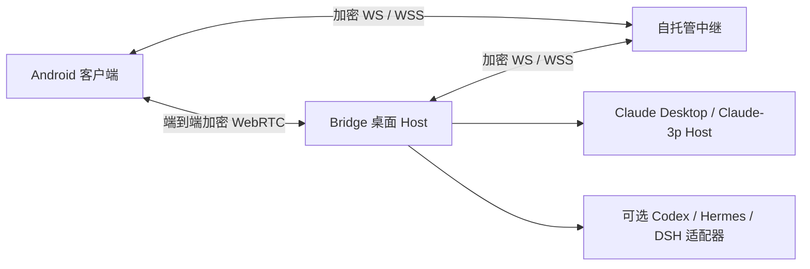

# Bridge · Lycidas97 Fork

[English](README_EN.md) · [上游项目](https://github.com/czhmartinez/claude-desktop-bridge) · [贡献指南](CONTRIBUTING.md)


通过 Android 手机远程使用电脑上的 Claude Desktop：查看会话、继续任务、处理授权与提问、创建 Fork，以及预览和传输工作区文件。手机与 Bridge 桌面端通过端到端加密连接通信。

这是独立维护的 fork，目前主要围绕 **macOS + Android + Claude** 的实际使用完善体验。保留上游的 Codex、Hermes、DSH 适配器，但新客户端默认只显示 Claude，其他 Agent 可在设置中选择显示。

## 维护进度

更新于 **2026-10-30**。项目基础版本仍为 **1.0.2**；下述进展不代表已发布新的正式版本。

| 位置 | 当前状态 |
| --- | --- |
| [`main`](https://github.com/Lycidas97/claude-desktop-bridge/tree/main) | 已包含前期合入的模型与上下文、历史、连接稳定性、Fork、图片/PDF 预览及文件下载改进。 |
| [`fix/bridge-session-media-and-connectivity`](https://github.com/Lycidas97/claude-desktop-bridge/tree/fix/bridge-session-media-and-connectivity) | 另有多层 Fork 完善、手机导航与队列续接修复、中继配置、文本预览、普通文件上传和 Agent 显示设置。最新功能提交为 [`61bcf26`](https://github.com/Lycidas97/claude-desktop-bridge/commit/61bcf26e504235a012546ec8ef8f35449b535b09)，尚未合入 `main`。 |
| 本地桌面构建 | macOS 菜单栏已改为透明底白色桥接图标，带普通屏/Retina 资源；图标源码尚未提交，不包含在上述远端分支中。 |

**体验下列最新功能时，请使用功能分支的源码，并同时更新电脑端与 Android 端。** fork 目前没有独立的 GitHub Release；上游安装包不包含本 fork 的全部改动。本地交付使用的 `v25`、`v26` 是构建标识，不是项目版本号。

## 本 fork 的主要改进

### 会话、Fork 与队列

- 手机提供“会话 / 电脑 / 设置”三个入口。进入电脑后默认停留在会话目录，显式打开会话才进入对话；对话与成果分开查看。
- 可从现有会话创建 Fork，也可继续从 Fork 创建子分支。手机与 Bridge 桌面端按直接父子关系递归显示，每层可独立展开、收起。
- 父会话归档后，仍活跃的后代会话继续可见；中间父节点不可见时，子会话挂到最近可见祖先，或单独显示。
- 修复上一轮结束后，已接收的下一条指令可能持续停在“排队”的问题。复用空闲 Bridge Host 时仍检查最新 transcript 完成边界，避免在 Claude Desktop 实际运行时抢占输入。
- 新会话通过公开 `claude://resume` 链接在 Claude Desktop 中登记。原生侧边栏的刷新与 Fork 收纳仍受 Claude Desktop 状态影响，部分变化需要重启后才能完整显示。

### 模型、上下文与完整历史

- 读取自定义 Claude-3p Gateway 的模型目录、显示名称与声明的上下文上限，取消 Bridge 固定 262,144 token 阈值造成的错误发送阻断。
- 向原生 Host 传递对应的自动压缩窗口，并识别 Desktop 端 compact 记录与压缩后的 token 信息。实际容量取决于模型、Gateway 和 Host 的支持。
- 长回复折叠显示，用户可展开全文；不再用“已省略中间部分”替换原始内容。保留压缩前后的历史消息，以及子代理的进度与完整报告。
- 对话支持 Markdown、工具与子代理卡片、交互提问卡片；历史按需加载，补页时尽量保持阅读位置。

### 图片、PDF、文本预览与文件传输

| 功能 | 当前行为与限制 |
| --- | --- |
| 图片 | 对话和成果内预览；手机预览使用约 1600px 的缩放图像，减少等待。 |
| PDF | 客户端内嵌查看，沿用加密分块文件传输。 |
| 文本与代码 | **不超过 1 MiB（1,048,576 字节）的完整 UTF-8 文件**；Markdown 可切换渲染/源码，常见代码按语言高亮。超限、二进制或无效 UTF-8 明确报错，不截断冒充全文。 |
| 文件下载 | 从成果或对话中的工作区文件路径下载；保留项目范围与敏感路径检查。单文件上限 **20 MiB**。 |
| 普通文件上传 | 保留图片附件，另加普通文件选择、进度与移除。单文件上限 **20 MiB**，多文件依次上传，通过加密通道按 256 KiB 分块并校验 SHA-256。 |

上传文件保存在当前会话工作目录的 `.bridge-uploads/<uploadId>/<filename>`，不覆盖同名文件。发送消息时附上相对路径，只有文件也可发送。已保存的文件会保留；从输入区移除附件不会删除电脑上的文件。本仓库已忽略 `.bridge-uploads/`，其他项目需自行决定其 Git 忽略规则。

### 中继与 Agent 设置

- 电脑端“状态”和手机端“电脑 → 当前电脑 → 连接与同步”均可修改 WebSocket 中继地址并重连，支持 `ws://`、`wss://`、端口和路径。这里配置的是中继服务器，不是 HTTP/SOCKS 代理。
- 设置分别保存在当前设备。迁移服务器时两端须填写相同地址；手机离线也可编辑。显式保存的地址优先于安装包默认值和自动端点学习，升级不覆盖手动配置，保留既有配对身份。
- 手机“设置 → Agent 显示”、桌面“状态 → Agent 显示”管理可见 Agent。**默认只勾选 Claude**；其他 Agent 只有勾选且就绪后，才出现在会话目录、新建、应用控制和授权选择中。设置仅影响当前设备显示，不删除原生会话。
- 改进中继心跳、重连与大回复发送顺序，减少图片预览卡住和多个大响应互相争用链路的问题。

## 使用方式

1. 在电脑打开 Bridge，并准备好可用的 Claude Desktop / Claude-3p Host 环境。
2. 在 Android 安装相匹配的客户端，通过电脑端一次性二维码或配对链接添加电脑。
3. 手机选择电脑后进入会话目录，再打开或创建会话；在输入区发送消息、图片或普通文件，处理授权与提问。
4. 需要其他 Agent 时，在当前设备的 Agent 显示设置中勾选，并先使对应运行时就绪。

电脑端任务不会因手机退到后台而停止。重新连接后恢复事件与会话状态；在 Claude Desktop 内实际发送消息时，Bridge 继续遵守单写入者与冲突检查。Bridge 对原生 Desktop 的观察不保证其窗口实时刷新全部远程进度。

## 连接与部署



本 fork 当前的使用方式是本机桌面 Host + Android 客户端，服务器仅部署中继，**不需要把 WebUI 部署到公网**。Web/PWA 仍保留供本地开发使用。

- 业务正文通过每设备 AES-256-GCM 加密；中继可见路由元数据、密文及队列信息。
- 支持 WebRTC 直连、局域网中继与公网 WSS 回退。自托管部署需要配置自己的域名、TLS 和适当的 STUN/TURN。
- 不公开个人中继、配对链接、设备密钥或 API Key；示例环境使用占位域名。
- Codex、Hermes、DSH 的原生账号与会话保持隔离；运行时与提供方接力沿用上游的显式确认流程，不自动迁移凭据。

详见 [架构](docs/ARCHITECTURE.md)、[安全模型](docs/SECURITY.md) 与 [中继部署](docs/RELAY-REDEPLOY.md)。这些文档包含上游历史版本说明，最新 fork 状态以本页的分支进度为准。

## 本地开发与构建

要求 **Node.js ≥ 22.13** 和 npm。Android 构建还需 JDK、Android SDK；桌面安装包需对应平台工具链。

```bash
git clone https://github.com/Lycidas97/claude-desktop-bridge.git
```

```bash
cd claude-desktop-bridge
```

```bash
git switch fix/bridge-session-media-and-connectivity
```

```bash
npm ci
```

```bash
npm run dev:desktop
```

开发模式启动本地 Relay（`ws://127.0.0.1:8788/ws`）、客户端（`http://localhost:5188`）与 Electron Host。跨网络使用时，请配置两端一致的公网 WSS 中继。

构建默认地址可参考 `.env.example` 的 `BRIDGE_PUBLIC_RELAY_URL`、`BRIDGE_SERVICE_ORIGIN`、`VITE_BRIDGE_PUBLIC_RELAY_URL`、`VITE_BRIDGE_SERVICE_ORIGIN`。安装后的手动地址设置优先于这些默认值。

```bash
npm run build:android:debug
```

```bash
npm run package:adhoc -w @bridge/desktop
```

macOS ad-hoc 包用于本机验证；稳定签名与其他平台构建参见 [发布手册](docs/RELEASE.md)。不应把本机验证包当作已公证的正式发行版。

## 验证状态与已知限制

- 中继设置、文本预览和上传改动：协议测试 **35 项通过**；桌面测试 **280 项通过、3 项跳过**；客户端 **155 项通过、4 项既有失败**。既有失败位于自定义打包中继默认值下的配对迁移测试，未作为全绿结果报告。
- Agent 显示设置：**37 项相关测试**、客户端类型检查和构建通过；浏览器验证默认仅 Claude、勾选、未就绪隐藏、重载保存与 375px 布局。这些子集与前面的测试计数不可直接相加。
- 已通过真实加密中继上传多分块文件，并从电脑文件系统及文本预览通道回读核对哈希。
- Android v26 验证了 v1/v2/v3 签名、对齐、全部 **10 个 DEX**、包内资源及上传后回下载哈希；该构建尚未完成 Android 实机运行验收。
- 本轮主要验证平台为 macOS + Android 构建及浏览器。Windows、Linux、iOS 保留源码与上游构建入口，未对本 fork 最新功能重新完成各平台实机验收。
- 本地菜单栏图标已验证透明白色资源、1×/2×加载与应用签名；系统菜单栏截图受 macOS 录屏权限限制。

常用检查入口：

```bash
npm run typecheck
```

```bash
npm test
```

```bash
npm run probe:relay
```

## 目录与来源

| 目录 | 内容 |
| --- | --- |
| `apps/client` | 手机与桌面共享 React 界面 |
| `apps/desktop` | Electron Host、运行时适配、会话与文件传输 |
| `apps/mobile` | Android / iOS Capacitor 壳 |
| `apps/relay` | 密文中继与推送唤醒 |
| `packages/protocol` | 协议 V3、配对 schema V4、加密与可靠传输 |
| `deploy` / `docs` | 部署与技术文档 |

感谢 [czhmartinez/claude-desktop-bridge](https://github.com/czhmartinez/claude-desktop-bridge) 的原始项目与多运行时基础。本 fork 保留 **MIT** 许可证，见 [LICENSE](LICENSE)。
