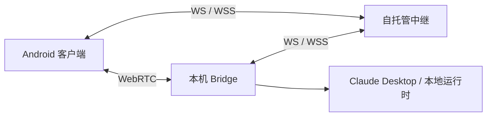

# Bridge · Lycidas97 Fork

[English](README_EN.md) · [下载](https://github.com/Lycidas97/claude-desktop-bridge/releases) · [更新记录](CHANGELOG.md) · [贡献指南](CONTRIBUTING.md)


**在 Android 手机上继续电脑里的 Claude 工作。**

Bridge 将电脑上的会话、任务进度、授权提问和工作区文件带到手机。你可以继续已有会话、排队发送下一条指令、创建 Fork、查看子代理和成果，也可以在离开电脑后处理等待中的授权。

这是独立维护的 fork，主要围绕 **macOS + Android + Claude** 完善日常使用。本文对应 **v1.2.1** 源码，包含 Magpie 连接设置、手机结构化审批、收件箱恢复与 Fork 边界修复。安装包与发布状态以本仓库的 [Releases](https://github.com/Lycidas97/claude-desktop-bridge/releases) 为准。保留上游 Codex、Hermes、DSH 适配器，默认只显示 Claude，其他 Agent 可在设置中启用。

## 开始使用

1. 从本 fork 的 Releases 下载电脑端和 Android 客户端，尽量使用同一版本。上游安装包不包含本 fork 的全部改进。
2. 在电脑上准备好可用的 Claude Desktop / Claude-3p Host 环境，启动 Bridge。
3. 在 Android 安装 APK，通过电脑端的一次性二维码或配对链接添加电脑。
4. 打开手机的会话目录，选择已有会话，或用右上角“+”创建会话。
5. 在对话中发送文本、图片或文件，查看执行进度，并处理授权与提问。

跨网络连接时，两端需要使用相同的可达中继。可在电脑端“状态”和手机端“电脑 → 连接与电脑设置”修改中继地址；它是 WebSocket 中继地址，支持 `ws://`、`wss://`、端口和路径。

已保存的中继设置优先于安装包默认值，升级保留配对身份和手动配置。电脑端需保持运行并联网；手机退到后台不会停止电脑上的任务。

## 会话与任务

### 继续已有工作

- 浏览原生 Desktop 与 Bridge 管理的会话，查看 Markdown、工具调用、任务计划、子代理进度和完整报告。
- 在支持的 macOS Claude Desktop 环境中，将输入送到经核验的原会话执行器，并按输入 UUID 跟踪接收与完成；投递结果不确定时保留状态，不自动重发或另起执行器。
- 区分主轮执行、等待授权、后台 Agent / Bash 与进程存活，避免把后台任务或 Fork 子进程误算为父会话一直忙碌。
- 运行中可排队下一条指令；支持的执行来源还可立即调整当前任务。队列、附件和消息回执保留各自身份，重连后恢复状态。
- 授权与 `AskUserQuestion` 在手机和电脑之间同步，已处理的请求及时收起。停止任务、删除会话等操作保留确认。

Bridge 的后台服务负责连接、队列和任务。关闭再打开 Bridge 窗口会重新连接服务；**关闭窗口与停止后台服务是不同的操作**。

### 整理与创建会话

- 按项目浏览、搜索和归档会话；Fork 按直接父子关系逐层展开，支持从分支继续创建分支。父会话归档后，活跃后代仍可查看。
- Fork 从选中父链的完整轮次边界创建；当前未完成的一轮不复制，父分支任务不成为子分支的运行中任务。分支共享工作目录，创建分支不会回滚文件。
- 在会话列表或对话操作中重命名。名称持久保存在 Bridge 中，重启后仍在；它是 Bridge 显示名，不改写 Claude Desktop 的原生标题和会话文件。
- 新建会话时，在同一入口选择最近工作文件夹或浏览电脑目录。点击子目录先进入，确认当前目录后才选中；项目分组与实际工作目录分别设置。
- 返回目录再打开会话时保留未发送草稿。新建表单在浏览目录、取消文件夹选择和从文件夹选择返回时保留已填内容。

### 模型、上下文与大会话

- 从当前 Gateway 读取模型名称和声明的上下文容量，保留模型与思考强度设置，识别压缩记录和压缩后的 token 信息。
- 长回复可折叠并展开全文，保留压缩前后的历史与子代理报告。
- 目录、历史和成果按需加载；逐步补页、延迟加载媒体，并合并频繁进度更新，减少大 JSONL、大回复与重连时的重复读取和传输。

实际上下文容量、立即调整和模型设置生效方式取决于执行来源。已经运行的 Claude Desktop 进程可能需要重启才能加载只写入磁盘的模型设置；原生窗口和侧边栏也不保证实时呈现 Bridge 中的全部变化。

原 Desktop 会话的 inbox 输入仍属于会话间消息，“会话已接收”表示消息送达，不表示授权已提交。手机仅对实时、可关联的权限请求提交允许、拒绝或问答答案；未接通原生响应通道的阻塞确认和历史问答会标明需要在电脑端处理。实际原生审批覆盖取决于 Desktop 是否发出对应 Hook 事件。

## 手机端怎么操作

一级页面为**会话、电脑、设置**，通过顶栏左上角菜单切换。进入电脑或从菜单选择“会话”时打开会话目录，选择具体会话后才进入对话。

| 要做的事 | 入口 |
| --- | --- |
| 新建会话、选择工作文件夹 | 会话目录右上角“+” |
| 重命名、模型与会话设置、Fork、归档 | 会话行或对话顶栏“⋯” |
| 查看成果与文件变化 | 对话“⋯”中的成果入口 |
| 切换电脑、修改连接、管理配对 | 电脑页与电脑行“⋯” |
| 外观、Agent 显示、Magpie 额度、诊断 | 设置页 |

Android 系统返回键按页面层级工作：

- 软键盘显示时，先由系统收起键盘；菜单、弹窗和底部面板先关闭。
- 成果返回对话，对话返回原目录或项目列表；项目和归档列表返回会话目录。
- 电脑详情返回电脑列表，电脑和设置返回会话目录。
- 会话目录根页再返回，应用退到后台；再次打开可以继续工作。

返回和切页不发送草稿，也不停止电脑端任务。完整页面规范见 [手机导航](docs/MOBILE-NAVIGATION.md)。

## 预览与文件传输

| 类型 | 支持范围 |
| --- | --- |
| 图片 | 对话和成果内预览，手机端使用缩放图像减少等待 |
| PDF | 客户端内嵌查看，通过加密分块通道读取 |
| 文本与代码 | 完整 UTF-8 文件，最大 **1 MiB**；Markdown 支持渲染 / 源码切换，常见代码支持高亮 |
| 文件下载 | 从成果或对话中的工作区路径下载，单文件最大 **20 MiB**，保留工作区和敏感路径检查 |
| 文件上传 | 图片和普通文件，单文件最大 **20 MiB**；显示进度，按 **256 KiB** 分块加密传输并核验 SHA-256 |

超限、二进制或无效 UTF-8 文本会明确报错，不以截断内容代替全文。上传文件保存在会话工作目录的 `.bridge-uploads/<uploadId>/<filename>`，发送时附上相对路径；可以只发送文件。从输入区移除附件不会删除已保存在电脑上的文件。

## Magpie 接入与额度

电脑端打开“设置 → 提供方 → Magpie 连接”，可选择沿用 Claude/Claude-3p 配置，或手动填写网关 URL、认证方式（Bearer / x-api-key）和 Magpie Key。“测试连接”分别检查模型与额度接口，不保存配置；“保存 Magpie 配置”验证模型列表并在电脑本地加密保存 Key。模型发现、额度读取和随后启动的 Bridge 执行器使用选定配置；运行中的执行器保留原配置。手机端可查看当前来源和连接状态，Key 不会回传。切回自动配置后重新使用 Claude/Claude-3p 的配置。

使用兼容的 Magpie Gateway 时，可在“设置 → Magpie 额度”查看账号、套餐、各额度窗口、余额和重置时间；会话模型选择中也会显示相应额度信息。

- 按需读取，看板和模型设置共用读数；没有后台定时轮询。
- 点击刷新会主动请求当前网关可见的本机账号重新采样。远端来源保留原采样并标明状态，不转发本机认证。
- 区分 Bridge 读取时间和上游采样时间；冷却、旧读数和失败都有对应提示，HTTP 成功不等于取得了新采样。
- 断线或离开页面后不自动重放主动刷新。刷新额度不会切换账号、模型或路由。

详见 [插件说明](plugins/magpie-quota/README.md)。

## 连接与数据边界



手机与 Bridge 之间的业务正文使用每设备 AES-256-GCM 端到端加密。中继可见连接、路由、密文与队列元数据。支持 WebRTC 直连和中继回退，实际连接方式取决于网络与 ICE 配置。

本 fork 的日常部署是**本机桌面 Host + Android 客户端，服务器只运行中继**，无需向公网部署 WebUI。Web/PWA 保留供开发使用。模型凭据留在电脑端，各运行时的账号和会话保持隔离；跨运行时接力需要显式确认。

| 文档 | 内容 |
| --- | --- |
| [架构](docs/ARCHITECTURE.md) | Host、协议、运行时与数据流 |
| [安全模型](docs/SECURITY.md) | 加密、配对、权限与文件边界 |
| [中继部署](docs/RELAY-REDEPLOY.md) | 自托管中继与迁移 |
| [后台服务](docs/BACKGROUND-SERVICE.md) | 窗口、后台进程与状态恢复 |

## 自建中继

服务器使用 Docker Engine 与 Docker Compose，从本 fork 的 `main` 源码构建中继镜像。提供独立的 [仅中继 Compose](deploy/relay-only.compose.yml) 和 [自动 TLS 配置](deploy/relay-only.Caddyfile)：只有 Relay 与 Caddy，公网 TCP 80 / 443，Relay 的 8788 只在 Docker 网络内使用。HTTPS 根路径和 `/metrics` 返回 404。

在已克隆的仓库根目录创建配置：

```bash
cp deploy/relay-only.env.example .env
```

将 `.env` 中的 `BRIDGE_DOMAIN` 改为自己的域名，确保 DNS 指向服务器、80 / 443 可达，再构建并启动：

```bash
docker compose --env-file .env -f deploy/relay-only.compose.yml up -d --build
```

两端中继地址均填写 `wss://你的域名/ws`。数据库、备份与 TLS 证书使用持久化卷。完整的首次安装、WSS 探测、两端配置、备份与升级步骤见 [自建中继指南](docs/RELAY-REDEPLOY.md)。已有反向代理或旧中继部署时，先按指南确认端口与原数据卷。

## 开发与验证

开发与 CI 使用 **Node.js 26 LTS** 和 npm，版本选择见 [.nvmrc](.nvmrc)；安装了 nvm 时，可先运行 `nvm install` 和 `nvm use`。最低兼容版本仍为 Node.js 22.13。Electron 使用其自带的 Node.js 运行时。Android 构建另需 JDK 21 与 Android SDK，桌面和 iOS 构建需要对应平台工具链。

```bash
git clone https://github.com/Lycidas97/claude-desktop-bridge.git
```

```bash
cd claude-desktop-bridge
```

```bash
npm ci
```

```bash
npm run build -w @bridge/protocol
```

```bash
npm run dev:desktop
```

开发模式启动本地 Relay（`ws://127.0.0.1:8788/ws`）、React 客户端（`http://localhost:5188`）和 Electron Host。构建默认连接参数见 [.env.example](.env.example)，安装后的手动设置优先。

| 命令 | 用途 |
| --- | --- |
| `npm run verify` | 全部类型检查、五组回归测试和完整构建 |
| `npm test` | 桌面、客户端、协议、中继、Magpie 插件回归 |
| `npm run test:infra` | 测试入口、失败传播与回收站清理约定 |
| `npm run test:browser` | 实际 App、加密协议和本地中继上的六个隔离浏览器场景 |
| `npm run ci:run -- run build:android:debug` | 构建 Android APK，并检查原生插件注册和全部 DEX |
| `npm run ci:run -- run make:adhoc -w @bridge/desktop` | 构建 macOS ad-hoc 测试安装包 |

验证入口通过系统回收站清理 Node 临时文件；Linux 需安装 `trash-cli`。浏览器测试的桌面响应和模型输出为模拟数据，不访问生产会话。浏览器准备、报告位置与覆盖范围见 [测试说明](docs/testing.md)。

本 fork 主要在 macOS + Android 上验证。Android 系统返回已在 Android 16 模拟器中验收；Windows、Linux、iOS 保留构建和 CI 入口，但构建通过不代表各平台实机体验已完成验收。macOS ad-hoc 包未经 Apple 公证，iOS 无签名构建也不等于可直接安装的 IPA。

版本统一后由 `main` 自动创建 Release 草稿，平台产物任务全部成功才公开发布。完整规则见 [贡献指南](CONTRIBUTING.md#release-rules)，历次功能与修复见 [Changelog](CHANGELOG.md)。

## 目录与来源

| 目录 | 内容 |
| --- | --- |
| `apps/client` | 手机与桌面共享 React 界面 |
| `apps/desktop` | Electron Host、后台服务、会话与文件传输 |
| `apps/mobile` | Android / iOS Capacitor 壳 |
| `apps/relay` | 密文中继与推送唤醒 |
| `packages/protocol` | 协议、配对、加密与可靠传输 |
| `plugins/magpie-quota` | 额度读取、主动刷新与展示 |
| `scripts` / `deploy` / `docs` | 验证、构建、部署与技术文档 |

感谢 [czhmartinez/claude-desktop-bridge](https://github.com/czhmartinez/claude-desktop-bridge) 的原始项目与多运行时基础。本 fork 保留 **MIT** 许可证，见 [LICENSE](LICENSE)。
