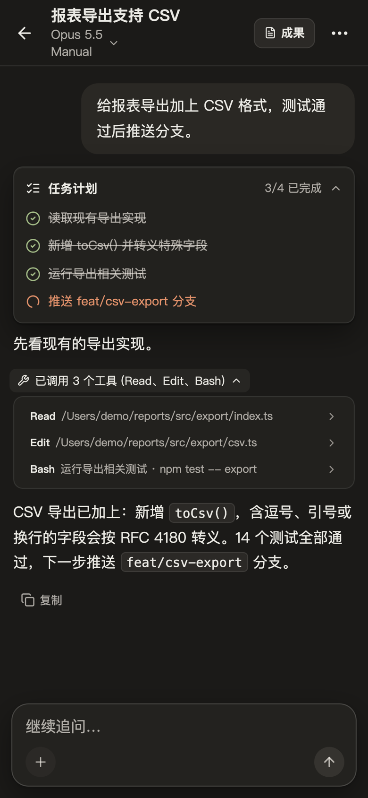
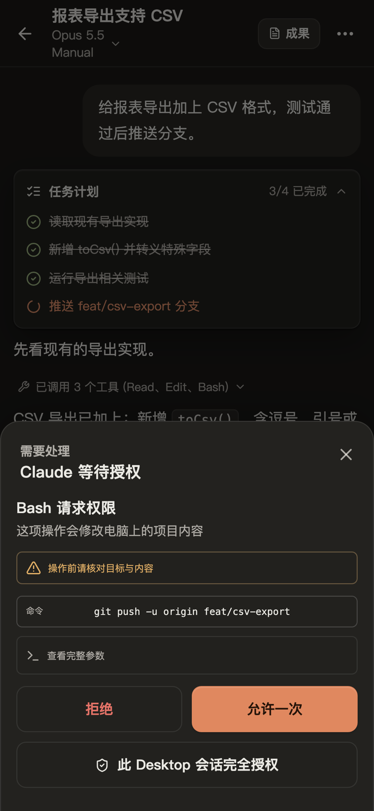

<p align="center">
  
</p>

<h1 align="center">Bridge</h1>

<p align="center"><strong>在 Android 手机上继续电脑里的 Claude 工作。</strong></p>

<p align="center">
  <a href="README_EN.md">English</a> ·
  <a href="https://github.com/Lycidas97/claude-desktop-bridge/releases/latest">下载</a> ·
  <a href="CHANGELOG.md">更新记录</a> ·
  <a href="CONTRIBUTING.md">贡献指南</a>
</p>

<p align="center">
  
  &nbsp;
  
</p>

Bridge 把 Claude Desktop 的本地 Code 会话带到手机。任务仍在你的电脑上运行，手机用来跟进进度、继续对话、处理需要你决定的事。

Bridge 为 **Claude-3p**（通过第三方网关使用的 Claude Desktop）开发：Claude 官方的 Remote Control 不支持网关模式，Bridge 补上了这一块。

- **接着聊**：在原生会话里发送文本、图片或文件，查看工具调用、任务计划和子代理进度。
- **排队与调整**：任务运行中排队发送下一条指令，或在 Desktop 支持时立即调整。
- **回答授权与提问**：实时答复权限请求和提问，已处理的请求在各设备同步收起。
- **查看成果**：预览和下载工作区文件，单文件最大 20 MiB。
- **端到端加密**：每台设备独立密钥；能直连时走 WebRTC，否则由中继转发密文。
- **扫码配对**：一次性二维码，十分钟内有效。

日常使用与验证主要围绕 **macOS + Android**。Bridge 依赖 Desktop 的本地 `LocalSessions` 接口，可用操作取决于已安装的 Desktop 版本和账号 / 工作区策略；普通网页聊天记录不在这条接入路径内。除 Android 原生客户端外，通用手机 Web 客户端继续保留；原生 iOS 已退役。

> [!CAUTION]
> **用官方账号登录时，请自行评估封号风险。** Bridge 也能连接官方账号登录的 Claude Desktop，但它通过本机调试接口操作 Desktop，这不是 Anthropic 支持的用法。Bridge 只在本机调用 Desktop 自带的会话功能，原则上不太会触发封号，但无法排除这一风险。

<a id="版本与下载"></a>

## 下载与安装

从 [最新发布](https://github.com/Lycidas97/claude-desktop-bridge/releases/latest) 下载电脑端和手机端，两端尽量使用同一版本。本文随 `main` 源码维护，可能领先于已发布版本。

| 平台 | 发布产物 | 说明 |
| --- | --- | --- |
| macOS | `Bridge-<version>-macos-adhoc.zip` | ad-hoc 签名，未经 Apple 公证；主要验证平台 |
| Android 8.0+ | `Bridge-<version>-android-debug.apk` | 使用仓库固定的 debug 签名 |
| Windows | `Bridge-<version>-windows-installer-ci.zip` | CI 构建，签名状态见包内 `windows-release-evidence.json`；原生连接未完成实机验收 |

发布页同时提供 `SHA256SUMS.txt` 与 `SOURCE_COMMIT.txt`。构建成功不代表各平台都完成了实机验证；Android 系统返回流程已在 Android 16 模拟器中验证。

- **macOS**：解压后使用包内安装包，把 Bridge 放入“应用程序”。系统拦截未经公证的应用时，核对来源后使用“仍要打开”等系统入口。
- **Android**：安装 APK 时，允许当前下载来源安装应用。

使用安装包不需要另装 Node.js、npm 或 Android SDK。

Bridge 1.3.10 的托管助理可下载、处理和发送邮件附件，也可提案打开或发消息到已有会话、新建会话；所有提案仍需你确认。助理邮件使用折叠的收件行和独立的原文阅读器；SMTP 已接受的邮件，在服务器标出唯一的「已发送」文件夹且尚无副本时，会归档到其中。新建会话的首条消息可带附件，也可新建工作目录；桌面已有会话支持 Ctrl+Enter 发送。Claude 自行关闭调试端口后，Bridge 不会自动重开，需从手机或原生菜单重新开启。助理支持多个邮箱；IMAP 收信和 SMTP 发信都需要电脑端 Bridge 运行在 macOS 上。详见 [1.3.10 更新记录](CHANGELOG.md#1310)。

## 首次连接

开始前确认三件事：

- **电脑**：已安装并登录 Claude Desktop 或 Claude-3p，本地 Code 会话能正常使用；电脑保持开机、联网，Desktop 保持运行。
- **手机**：已安装 Android Bridge，不需要在手机上配置模型 API Key。
- **中继**：两端能访问同一个 WebSocket 中继，用于配对、连接和直连失败时的转发。可以使用已有可信中继，或[自建中继](docs/RELAY-REDEPLOY.md)；服务器只需运行中继，不需要部署公网 WebUI。

手机离开前台后，电脑上的任务继续；电脑休眠、断网或退出 Desktop 会影响连接和任务。

### 1. 打开 Bridge

先启动一次 Claude Desktop / Claude-3p 并完成登录，再打开 Bridge。两处状态需要分别检查：

- **设置 → Claude 接入 → 原生桌面通道**：连接 Desktop，就绪时显示「通道已就绪」。
- **设置 → 连接与启动 → 主机状态 / Relay 状态**：连接手机与中继。

### 2. 开启 Desktop 的本机连接（macOS）

这一步包含两个设置：允许 Desktop 显示开发者工具，再开启主进程调试端口。

1. 在 Bridge 打开 **设置 → Claude 接入 → Claude Desktop 开发者工具**。同时检测到 `Claude` 与 `Claude-3p` 时，选择实际使用的配置目录。
2. 确认 `developer_settings.json` 中的 `allowDevTools` 为 `true`。“一键开启”只写入这个字段，**不会开启 inspector，也不保证弹出 macOS 权限请求**。按钮置灰或检查失败时，按下方手动配置。
3. 等当前任务结束，退出并重新打开 Desktop，让配置在下一次启动时加载；Bridge 不会替你重启它。
4. 在 Desktop 原生菜单选择 **Developer → Enable Main Process Debugger**，默认地址为本机 `127.0.0.1:9229`。菜单可能受账号 / 工作区策略限制，原生操作也可能打开 Chrome 调试页。
5. 回到 **设置 → Claude 接入**，确认 Claude 通道为“已就绪”或“运行中”，并查看同页 **调试连接监测** 的错误。端口开放本身不代表 `LocalSessions` 已可用。

<details>
<summary>按钮不可用时，手动配置 developer_settings.json</summary>

使用与你运行的应用对应的文件：

- Claude：`~/Library/Application Support/Claude/developer_settings.json`
- Claude-3p：`~/Library/Application Support/Claude-3p/developer_settings.json`

先启动一次对应应用，让它创建配置目录。等任务结束并退出 Desktop，备份现有文件，再用文本编辑器将 JSON 对象中的 `allowDevTools` 设为 `true`，保留其他字段。文件不存在时，在已有配置目录中新建：

```json
{
  "allowDevTools": true
}
```

确认文件是有效 JSON 后重新打开 Desktop，再从原生菜单开启主进程调试。不要把这段内容覆盖到 `claude_desktop_config.json`，那是另一份配置。出现文件权限或 JSON 错误时先处理具体错误，重新检查按钮不会代替修复文件。

</details>

**自动开启**：macOS 后台发现新的 Desktop 进程后，会通过同一个原生菜单尝试开启一次 inspector。

- 需要在 **系统设置 → 隐私与安全性 → 辅助功能** 中允许 Bridge；**自动化** 中出现相应项时，也允许 Bridge 控制 System Events。这些是菜单自动化权限，与 JSON 文件写入无关。
- 端口已开放时跳过。实际操作失败、你手动关闭，或 Claude 在开启约 15 分钟后自行关闭时，同一个 Desktop 进程内不再尝试，重启 Bridge 也不重试。这时可直接使用原生菜单，或在手机 **设置 → 连接与电脑设置** 点 `开启调试端口` 请求电脑再试一次；手机请求同样受账号 / 工作区策略和上述权限约束。
- 首次授权弹窗与完整重启流程尚未在已安装应用上完成端到端验收。

> [!WARNING]
> **9229 只供本机访问。** 它是有进程求值能力的调试端口，不是手机的连接地址，不要转发到公网或暴露给中继。连接监测只提供提醒，不会阻止其他本机进程连接。

### 3. 设置中继地址

在电脑 Bridge 的 **设置 → 连接与启动** 检查中继地址。自建或切换中继时，填入完整的 WebSocket 地址（如 `wss://relay.example.com/ws`），保存并重连；明文 `ws://` 只在可信局域网中使用。

- 显式保存的地址优先于安装包默认值。升级不会覆盖手动设置，也不会重建配对身份。
- 使用局域网中继时，手机必须能访问那台电脑或服务器的局域网地址，`127.0.0.1` 不能指向另一台设备；跨网络使用需要两端都可达的中继。
- 首次配对会把连接信息交给手机。已配对后再切换地址，还要在手机 **电脑 → 电脑行“⋯” → 连接与电脑设置 → 中继地址** 改成同一地址。

### 4. 配对手机

1. 在电脑 Bridge 打开 **设置 → 手机配对与设备 → 添加手机**，生成一次性二维码。
2. 手机首次启动时选择“扫描二维码”，允许相机访问后扫描。无法扫描时，支持 Pairing V4 的手机端也可粘贴从电脑复制的完整配对链接。以后添加其他电脑，从手机“电脑”页右上角“+”进入。
3. 二维码十分钟内有效，并绑定首次使用它的手机安装；过期或换手机时重新生成。配对链接包含设备授权信息，不要公开分享。
4. 配对成功后，在会话目录选择电脑上已有的 Code 会话，确认能加载历史，再发送指令。

## 常用操作

手机首页是会话列表。左上角菜单打开抽屉，底部只有 **电脑** 和 **设置** 两个入口（另有“助理”胶囊）：电脑页负责切换与管理配对，设置页负责外观、额度与诊断。

### 会话

- **新建会话**：点抽屉顶部的 **新建会话**，或项目分组标题右侧的“+”，填写名称并选择电脑上的工作文件夹。浏览进入目录后再确认当前目录；项目分组与实际工作目录分别选择。
- **继续对话**：发送文本、图片或文件。Desktop 负责执行，Bridge 同步进度、工具调用、任务计划和子代理报告。
- **排队与调整**：任务运行中可排队发送，或在 Desktop 支持时“立即调整”。尚未开始处理的原生消息可用 **Send now** 或撤回，是否仍可操作由 Desktop 判断。
- **回答提问与授权**：在会话的实时提问或授权入口答复；单选、多选、文本与授权选项依请求而定。已处理的请求会同步收起，历史卡片不能再作为实时授权提交。
- **模型、思考强度与输出风格**：会话行或对话顶栏“⋯” → **会话设置**。可用模型、上下文容量和设置生效方式由 Desktop 提供。新建会话页可预选内置样式或电脑 `~/.claude/output-styles` 中的个人样式；项目和插件样式在会话初始化后从会话设置选择。输出风格从下一轮回复生效。
- **回退**：已发送消息旁点“回退”，先预览再选择范围。对话回退会停止当前任务，移除所选消息及之后的对话，原文回填输入框，附件需重新添加。仅回退对话时保留当前文件；恢复文件受 Desktop 检查点与忙碌状态限制，会覆盖预览列出的文件。
- **Fork**：会话“⋯” → Fork，历史边界由 Desktop 决定。**分支共享工作目录，Fork 不复制或回滚项目文件。**
- **查看文件与成果**：对话“⋯”中的 **成果** 入口，或消息里的工作区路径；支持预览和下载，限制见[文件与额度](#文件与额度)。
- **整理会话**：搜索、按项目浏览、展开 Fork、重命名或归档，可把会话拖到其他分组；Git 项目分组可识别 worktree。删除会作用于 Desktop 原生会话与记录，请看清确认框。
- **阅读较早内容**：上翻暂停自动跟随，回到底部恢复。返回目录会保留未发送草稿，切页不会发送草稿或停止任务。

### 执行与投递

Claude 的任务、队列和审批由 Desktop 管理，Bridge 不另起 Claude SDK / CLI 执行器。投递状态不确定时不会自动重发；先核对会话历史与状态，再决定下一步，避免重复指令。

### 后台服务与升级

关闭 Bridge 窗口不会停止后台连接，手机仍可访问；停止后台服务会断开手机，Claude 原生任务的生命周期仍由 Desktop 管理。

升级电脑端后，等任务结束，从托盘选择 **停止后台服务并退出…**，再打开新版，后台代码才会更新。详见[后台服务](docs/BACKGROUND-SERVICE.md)。

## 文件与额度

| 类型 | 支持范围 |
| --- | --- |
| 图片 | 在对话与成果中预览，可使用缩放图像 |
| PDF | 客户端内嵌查看，经加密分块通道读取 |
| 文本 / 代码 | 完整、有效的 UTF-8 文件；Markdown 渲染与源码切换，常见语言高亮；二进制文件请下载 |
| 上传 / 下载 | 单文件最大 **20 MiB**，按 **256 KiB** 分块加密传输；保存或分享前校验完整文件哈希 |

文本超过 **1 MiB** 时会先确认大小，确认后可在 20 MiB 上限内继续预览。

远程读取受工作区与敏感路径检查约束，项目外文件、`.env`、私钥等不会因配对而开放。上传文件保存在会话工作目录的 `.bridge-uploads/<uploadId>/<filename>`，发送时附上相对路径；可以只发文件不写文字。从输入框移除附件不会删除电脑上已上传的副本。

**Magpie 额度**：使用兼容的 Magpie Gateway 时，手机 **设置 → Magpie 额度** 可查看账号、套餐、余额、额度窗口与重置时间，模型设置中也会显示相关读数。主动刷新会请求网关重新采样；旧读数、冷却和失败单独标示，刷新不会切换账号或模型。Claude 的账号与模型执行配置仍在 Desktop 管理。连接配置与插件要求见 [Magpie 插件说明](plugins/magpie-quota/README.md)。

## 常见问题

- **Mac 的“一键开启”一直置灰**：确认已先启动过对应 Desktop、选对了 `Claude` / `Claude-3p` 目录，或是否已经开启、存在具体的读取 / JSON 错误；按[手动配置](#2-开启-desktop-的本机连接macos)处理。按钮置灰不表示在等待系统授权。
- **没有 Developer 菜单，或无法开启调试**：修改 `allowDevTools` 后是否完整退出并重开了 Desktop；查看账号 / 工作区策略。自动尝试失败后可手动使用菜单，Bridge 不会绕过原生限制。
- **端口开了但没有会话、无法操作**：查看 **设置 → Claude 接入** 中的具体错误；确认 Desktop 仍在运行、对应 Code 会话存在、当前 Desktop 构建提供所需的 `LocalSessions` 方法。普通网页聊天不会从这里导入。
- **配对失败或二维码过期**：重新生成二维码，确认电脑 Bridge 已连上可达的中继；扫描不可用时粘贴配对链接。
- **手机显示电脑离线**：检查电脑是否休眠或断网、Bridge 后台是否运行，两端保存的中继地址是否一致且可达，TLS 与 `/ws` 路径是否正确。
- **更新后仍显示旧能力**：旧后台服务可能仍在运行，按[后台服务与升级](#后台服务与升级)重启后台；两端尽量同版。
- **消息一直排队或投递未确认**：先看 Desktop 的当前任务、授权等待和原生队列，再核对历史；不要因为网络超时重复发送。
- **文件预览失败**：文件是否仍在工作区内且可读，是否触及敏感路径、1 MiB 的大小确认或 20 MiB 传输上限。
- **锁屏后收不到即时通知**：先检查系统通知权限；在线本地提醒不等于后台推送。Android FCM 需要另配应用与服务凭据，最小中继部署不保证锁屏即时唤醒。

继续排查时，电脑在 **设置 → 诊断与支持** 导出诊断，手机在 **设置 → 连接诊断与日志** 查看连接问题。反馈时附上版本、平台、出错步骤和具体提示，不要附配对链接、密钥或聊天正文。可复现的问题请提交到 [Issues](https://github.com/Lycidas97/claude-desktop-bridge/issues)。

## 文档与开发

手机与电脑之间的业务正文使用每设备 AES-256-GCM 端到端加密。中继只转发密文，可见连接、路由、大小和队列元数据；账号凭据不会发送到手机或中继。WebRTC 与中继使用同一配对身份，电脑不需要把 inspector 暴露给手机。

- [自建中继](docs/RELAY-REDEPLOY.md) · [部署配置](deploy/README.md)：首次部署 WSS、迁移地址、备份或升级，含 Relay + Caddy 最小方案。
- [安全模型](docs/SECURITY.md)：配对、调试端口、文件访问与数据边界。
- [架构](docs/ARCHITECTURE.md) · [原生接入验收记录](docs/HOSTING-REFACTOR.md)：`LocalSessions`、数据流和实际验证范围，历史实现另有标记。
- [后台服务](docs/BACKGROUND-SERVICE.md)：区分窗口与服务，排查启动、断线和更新。
- [贡献指南](CONTRIBUTING.md) · [测试说明](docs/testing.md)：从源码开发、构建与验证。

从源码开发使用 [.nvmrc](.nvmrc) 指定的 **Node.js 26 LTS** 和 npm。克隆仓库后，在根目录依次运行：

```bash
npm ci
```

```bash
npm run build -w @bridge/protocol
```

```bash
npm run dev:desktop
```

开发模式会启动本地 Relay、React 客户端和 Electron Bridge；手机不能通过自己的 `127.0.0.1` 访问电脑上的服务。构建默认参数见 [.env.example](.env.example)，安装后保存的手动连接设置优先。Android 打包还需要 Android 工具链；测试与发布规则见贡献指南。

---

Bridge 起步于 [czhmartinez/claude-desktop-bridge](https://github.com/czhmartinez/claude-desktop-bridge)，沿用 **MIT** 许可证，见 [LICENSE](LICENSE)。
