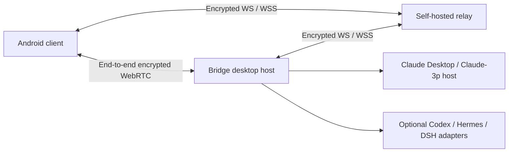

# Bridge · Lycidas97 Fork

[中文](README.md) · [Upstream](https://github.com/czhmartinez/claude-desktop-bridge) · [Contributing](CONTRIBUTING.md)


Use Claude Desktop from an Android phone: browse sessions, continue tasks, handle approvals and questions, create forks, and preview or transfer workspace files. The phone and Bridge desktop host communicate over an end-to-end encrypted connection.

This independently maintained fork currently focuses on **macOS + Android + Claude**. Upstream adapters for Codex, Hermes and DSH remain available, while new clients show only Claude by default. Other Agents can be enabled in settings.

## Development status

Updated **2026-10-31**. Current version: **1.0.3**.

| Location | Status |
| --- | --- |
| [`main`](https://github.com/Lycidas97/claude-desktop-bridge/tree/main) | The shared maintenance branch contains the features below, malformed relay request handling, mobile host-switch synchronization fixes and fixed gateway credential support for current Claude Desktop versions. |
| Historical branches | Merged feature and integration branches have been removed; their commits remain in `main`. Older `codex/*` branches with unique commits are retained. |
| macOS menu bar | Uses a transparent white bridge icon with standard/Retina assets and system appearance adaptation. The icon source is committed. |

**Build from `main` and update both desktop and Android clients to use the features described here.** This fork has no independent GitHub Release yet. Upstream installers do not contain all fork changes. Local delivery labels such as `v25`, `v26` and `v27` identify builds, not project versions.

## Improvements in this fork

### Sessions, forks and queues

- Three mobile tabs: Sessions, Computers and Settings. Opening a computer lands on its session directory; a conversation opens only when selected. Conversation and evidence views are separate.
- Create a fork from an existing session, then fork that branch again. Mobile and Bridge desktop render the immediate parent/child tree recursively, with independent expansion at each level.
- Active descendants remain visible when a parent is archived. If an intermediate parent is unavailable, descendants attach to the nearest visible ancestor or appear as roots.
- Fixed queued instructions remaining stuck after the preceding turn completed. Reusing an idle Bridge host still checks the latest transcript turn boundary before sending input while Claude Desktop may be active.
- New sessions are registered in Claude Desktop through its public `claude://resume` link. Native sidebar refresh and fork grouping depend on Claude Desktop state; some changes require a restart to appear fully.

### Models, context and complete history

- Discover custom Claude-3p Gateway model names and advertised context limits, removing false send blocks caused by Bridge's fixed 262,144-token threshold.
- Pass the corresponding auto-compaction window to the native host and recognize Desktop compaction records and post-compaction token information. Actual capacity depends on the model, Gateway and host.
- Fold long responses with an option to expand the full text, rather than replacing their middle with an omission marker. Preserve history across compaction and retain complete subagent reports and progress.
- Render Markdown, tool/subagent cards and interactive questions. Load history progressively and preserve the reading position when fetching older pages where possible.

### Previews and file transfers

| Feature | Behavior and limits |
| --- | --- |
| Images | Preview in conversations and evidence; mobile previews use images scaled to roughly 1600px to reduce waiting. |
| PDF | View inside the client using encrypted chunked file transfers. |
| Text and code | Complete UTF-8 files up to **1 MiB (1,048,576 bytes)**. Switch Markdown between rendered and source views; highlight common code languages. Oversized, binary and invalid UTF-8 files produce an explicit error instead of a truncated preview. |
| Downloads | Download evidence and workspace file paths from conversations, with workspace confinement and sensitive-path checks. **20 MiB** per file. |
| Ordinary uploads | Separate file picker alongside image attachments, with progress and removal. **20 MiB** per file; multiple files upload sequentially in encrypted 256 KiB chunks with SHA-256 verification. |

Uploads are saved under `.bridge-uploads/<uploadId>/<filename>` in the session's working directory, without overwriting files with the same name. Sending a message appends relative paths; files can be sent without additional text. Saved files remain on the computer when removed from the composer. This repository ignores `.bridge-uploads/`; other projects control their own Git ignore rules.

### Relay and Agent settings

- Edit the WebSocket relay address in desktop Status or mobile Computers → current computer → connection settings. Supports `ws://`, `wss://`, ports and paths. This configures the relay server, not an HTTP/SOCKS proxy.
- Each device saves its own address. Set the same relay on desktop and phone when moving servers; the phone can edit its address while offline. Explicit settings take priority over packaged defaults and learned endpoints, survive upgrades and retain pairing identities.
- Manage visible Agents in mobile Settings → Agent visibility or desktop Status → Agent visibility. **Only Claude is selected by default.** Other Agents appear in sessions, creation, desktop controls and permission selectors only when enabled and ready. Preferences affect the current device's display and do not delete native sessions.
- Relay heartbeat, reconnect and large-response sequencing improvements reduce stalled image previews and contention between large responses.

## Using Bridge

1. Open Bridge on the computer with a working Claude Desktop / Claude-3p host environment.
2. Install the matching Android client and add the computer with its one-time QR code or pairing link.
3. Select the computer, then open or create a session. Send text, images or ordinary files and respond to approvals and questions.
4. To use another Agent, enable it on the current device and make its runtime ready first.

Desktop tasks continue when the phone goes into the background. Reconnection restores events and session state. Sending input inside Claude Desktop still triggers Bridge's single-writer/conflict checks. Observing native Desktop sessions does not guarantee that its window immediately refreshes all remote progress.

## Connections and deployment



The current setup uses a local desktop host and Android client, with only the relay on the server. **A public WebUI is not required.** Web/PWA support remains available for local development.

- Payloads use per-device AES-256-GCM. The relay sees routing metadata, ciphertext and queue information.
- Supports WebRTC direct connections, LAN relays and public WSS fallback. Self-hosting requires your own domain, TLS and suitable STUN/TURN configuration.
- Keep personal relay details, pairing links, device secrets and API keys private. Example environments use placeholder domains.
- Native Codex, Hermes and DSH accounts and sessions remain isolated. Runtime/provider handoffs retain upstream's explicit confirmation flow and do not automatically migrate credentials.

See [Architecture](docs/ARCHITECTURE.md), [Security](docs/SECURITY.md) and [Relay deployment](docs/RELAY-REDEPLOY.md). These documents include historical upstream descriptions; use the branch status above for the latest fork progress.

## Local development and builds

Requires **Node.js ≥ 22.13** and npm. Android builds also need a JDK and Android SDK; desktop installers require the appropriate platform toolchain.

```bash
git clone https://github.com/Lycidas97/claude-desktop-bridge.git
```

```bash
cd claude-desktop-bridge
```

```bash
git switch main
```

```bash
npm ci
```

```bash
npm run dev:desktop
```

Development mode starts a local relay at `ws://127.0.0.1:8788/ws`, a client at `http://localhost:5188` and the Electron host. For access across networks, configure the same public WSS relay on desktop and phone.

See `.env.example` for build defaults: `BRIDGE_PUBLIC_RELAY_URL`, `BRIDGE_SERVICE_ORIGIN`, `VITE_BRIDGE_PUBLIC_RELAY_URL` and `VITE_BRIDGE_SERVICE_ORIGIN`. Addresses saved in the installed app take priority over those defaults.

```bash
npm run build:android:debug
```

```bash
npm run package:adhoc -w @bridge/desktop
```

macOS ad-hoc packages are for local verification. See [Release documentation](docs/RELEASE.md) for stable signing and other platforms. A local verification build is not a notarized release.

## Verification and known limitations

- Relay settings, text previews and uploads: **35 protocol tests passed**; **280 desktop tests passed, 3 skipped**; **155 client tests passed, 4 pre-existing failures**. Existing failures concern pairing migration under custom packaged relay defaults; this is not an all-green suite result.
- Agent visibility: **37 focused tests**, client typecheck and build passed. Browser checks covered Claude-only defaults, toggles, hiding unready Agents, persistence after reload and a 375px layout. These subsets overlap the earlier counts and must not be added together.
- A multi-chunk upload was tested over the real encrypted relay, with hash-verified readback from both the desktop filesystem and the text-preview channel.
- Android v27 passed v1/v2/v3 signature checks, alignment, all **10 DEX** checks, verification of 238 Web assets and a hash check after downloading the uploaded APK. This build has not yet completed physical Android runtime acceptance.
- Both P1 fixes are deployed: malformed relay URLs/Origins return 400/403 without stopping the service, and mobile host switches discard asynchronous synchronization results from old connections. Pre-commit checks passed **37 client tests**, **25 relay tests**, **25 desktop credential/Host tests** and all three typechecks.
- Current Claude Desktop fixed gateway credentials can be passed directly to Agent SDK subprocesses without a Host credential file. A real request completed through the installed Bridge app, with pairing retained, an empty queue and no Claude Desktop restart.
- Current validation focuses on macOS, Android builds and browser flows. Windows, Linux and iOS retain source and upstream build entry points; the latest fork features have not been revalidated on physical devices across those platforms.
- The menu-bar icon passed transparent-white asset, 1×/2× loading and app-signature checks. Capturing the system menu bar was blocked by macOS Screen Recording permissions.
- Before merging, client and desktop typechecks passed, along with **18 desktop preview/build-environment tests** and **69 client Agent/media/session/permission tests**. These counts describe the merge verification subset, not a rerun of the full suite.

Common checks:

```bash
npm run typecheck
```

```bash
npm test
```

```bash
npm run probe:relay
```

## Repository layout and attribution

| Directory | Contents |
| --- | --- |
| `apps/client` | Shared mobile and desktop React UI |
| `apps/desktop` | Electron host, runtime adapters, sessions and file transfers |
| `apps/mobile` | Android / iOS Capacitor shells |
| `apps/relay` | Ciphertext relay and push wake |
| `packages/protocol` | Protocol V3, pairing schema V4, encryption and reliable transport |
| `deploy` / `docs` | Deployment and technical documentation |

Built on [czhmartinez/claude-desktop-bridge](https://github.com/czhmartinez/claude-desktop-bridge). This fork retains the **MIT** license; see [LICENSE](LICENSE).
