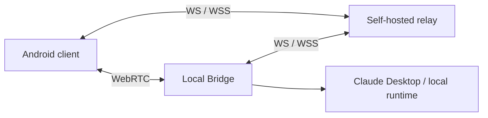

# Bridge · Lycidas97 Fork

[中文](README.md) · [Downloads](https://github.com/Lycidas97/claude-desktop-bridge/releases) · [Changelog](CHANGELOG.md) · [Contributing](CONTRIBUTING.md)


**Continue your computer's Claude work from an Android phone.**

Bridge brings desktop sessions, task progress, approvals, questions and workspace files to your phone. Continue an existing conversation, queue the next instruction, create a fork, inspect subagents and results, or answer an approval while away from your computer.

This independently maintained fork focuses on **macOS + Android + Claude**. **Version 1.3.1 improves native permission synchronization and connectivity**, with negotiated encrypted-body compression, Git project grouping, collapsible native/fork notices and Android system-bar theming. On macOS, it can attempt the native debugger menu once per newly discovered Desktop process, with user-granted Accessibility and Automation permission. Desktop's `LocalSessions` API still owns sessions, execution, queues and permissions. See the [Changelog](CHANGELOG.md) for details and this repository's [Releases](https://github.com/Lycidas97/claude-desktop-bridge/releases) for installers. This branch supports Claude Desktop, including Claude-3p. Independent Codex, Hermes and DSH adapters and cross-Agent handoff are retired. Saved configuration and history remain on disk. Models and quota features inside Claude Desktop, including Gemini, Antigravity and Magpie, remain available.

## Get started

1. Download desktop and Android packages from this fork's Releases, preferably from the same version. Upstream installers do not include all changes in this fork.
2. Start Claude Desktop, then Bridge. On macOS, Bridge uses the native **Enable Main Process Debugger** menu once per Desktop process start to open `127.0.0.1:9229`. Enable Desktop developer mode and grant Bridge Accessibility and System Events Automation permission when macOS requests it. Native account/workspace policies still apply; the native callback may open Chrome. An already-open port is skipped. Manual closure and failed attempts are respected across Bridge service restarts; details appear in Settings → Diagnostics and About. Bridge does not patch or restart Desktop.
3. Install the Android APK and add the computer using its one-time QR code or pairing link.
4. Open the session directory on your phone. Select an existing session or use “+” to create one.
5. Send text, images or files, follow execution progress, and respond to approvals and questions.

For access across networks, configure the same reachable relay on both devices. Change it in desktop Status or mobile Computers → connection and computer settings. This is a WebSocket relay address supporting `ws://`, `wss://`, ports and paths.

Saved relay settings override packaged defaults. Upgrades preserve pairing identities and explicit settings. Keep the computer running and connected; moving the phone app into the background does not stop desktop tasks.

## Sessions and tasks

### Continue existing work

- Browse native Desktop sessions and history, with Markdown, tool calls, task plans, subagent progress and complete reports.
- Submit Claude input through Desktop's `LocalSessions` API and track acceptance and completion by native message UUID. Uncertain delivery retains its state instead of automatically resending or starting a second executor.
- Distinguish the main turn, pending approvals, background Agent / Bash work and process liveness. Background tasks and forked child processes no longer incorrectly keep a parent session marked busy.
- Queue another instruction while a turn is running, or adjust the current task where the execution source supports it. Preserve queue entries, attachments and message receipts across reconnects.
- Synchronize approvals and `AskUserQuestion` between phone and computer, dismissing requests once handled. Stopping work and deleting sessions retain confirmation steps.

Bridge's background service forwards connections and events; Claude Desktop owns Claude execution and queues. Reopening the desktop window reconnects to the service. **Closing the window and stopping the background service are separate actions.**

### Organize and create sessions

- Browse projects, search and archive sessions. Expand forks by their immediate parent/child relationships, including deeper forks. Active descendants remain accessible after a parent is archived.
- Create Claude forks through Desktop's native API; Desktop determines the history boundary. Forks share the working directory and do not roll back files.
- Rename from the session list or conversation actions. Claude title changes are submitted to Desktop's native API.
- Choose a recent working folder or browse the computer through one session-creation entry point. Enter a subdirectory before confirming it; choose the project group separately from the actual working directory.
- Preserve unsent drafts when returning to the directory and reopening a session. The session-creation form retains entered values while browsing folders, canceling folder selection, or returning from the folder picker.

### Models, context and large histories

- Read or set Claude models, effort and context usage through Desktop's native API, according to the capabilities exposed by the installed Desktop.
- Fold long replies with access to the full text, preserving history across compaction and complete subagent reports.
- Load directories, history and evidence on demand. Page older content, defer media loading and coalesce frequent progress updates to reduce repeated work on large transcripts, responses and reconnects.

Context capacity, immediate steering and model-setting behavior depend on Claude Desktop. Claude permissions and question answers use Desktop's native channel. Bridge does not install permission Hooks or make approval decisions on Desktop's behalf; historical questions cannot be submitted as live approvals.

### Queued input and rewind

Use **Send now** or withdraw an eligible submitted, received or queued message through its original native command. Desktop decides whether the operation is still valid. Rewind previews conversation and file eligibility separately: conversation rewind stops active work and removes the selected message and later conversation, while file restoration remains subject to Desktop's checkpoints and busy state. Original text returns to the composer; attachments must be added again.

Scrolling up pauses automatic following during output. Returning to the bottom resumes it. Older history loads near the top while preserving the reading position. Native tool names and inputs remain visible across completion-only updates and history replay.

Claude now uses native Desktop session IDs and history directly, without importing legacy data or replaying retired Bridge execution requests. Pairing identities and existing data are preserved.

## Mobile navigation

The three main pages are **Sessions, Computers and Settings**, selected through the top-left header menu. Opening a computer or choosing Sessions opens the directory; a conversation opens when you select a session.

| Action | Location |
| --- | --- |
| Create a session and choose a working folder | “+” in the session directory |
| Rename, configure a model, fork or archive | “⋯” on a session row or conversation header |
| View evidence and file changes | Evidence entry in conversation “⋯” |
| Switch computers, edit connections and manage pairing | Computers and each computer's “⋯” |
| Appearance, Agent visibility, Magpie quota and diagnostics | Settings |

Android system back follows the current page hierarchy:

- The system dismisses an open keyboard first; menus, dialogs and sheets close before their underlying page.
- Evidence returns to the conversation, which returns to its directory or project list. Project and archive lists return to the session directory.
- Computer details return to the computer list; Computers and Settings return to the session directory.
- Back from the root session directory moves the app into the background. Reopen it to continue.

Back navigation and page changes neither send drafts nor stop desktop tasks. See the [mobile navigation guide](docs/MOBILE-NAVIGATION.md) for the full layout and interaction rules.

## Previews and file transfer

| Type | Support |
| --- | --- |
| Images | Preview in conversations and evidence, with scaled mobile previews |
| PDF | View inside the client through encrypted chunked transfers |
| Text and code | Complete UTF-8 files up to **1 MiB**; rendered/source Markdown and syntax highlighting for common languages |
| Downloads | Evidence and workspace paths from conversations, up to **20 MiB** per file, with workspace and sensitive-path checks |
| Uploads | Images and ordinary files, up to **20 MiB** per file, with progress, encrypted **256 KiB** chunks and SHA-256 verification |

Oversized, binary and invalid UTF-8 text produces an explicit error instead of a truncated preview. Uploads are stored under `.bridge-uploads/<uploadId>/<filename>` in the session's working directory, and sending appends relative paths. Files can be sent without additional text. Removing an attachment from the composer does not delete the saved file on the computer.

## Magpie connection and quota

The Magpie quota plugin remains available. Claude accounts, models and execution configuration are managed by Desktop; retired Host executor settings and standalone API-key lanes no longer execute Claude requests. Existing configuration is preserved, and credentials are not sent to the phone or relay.

With a compatible Magpie Gateway, open Settings → Magpie quota to view accounts, plans, quota windows, balances and reset times. Session model settings also show the corresponding quota information.

- Read on demand and share readings between the dashboard and model settings, without background polling.
- Explicit refresh requests new readings for visible local accounts on the current Gateway. Remote-source readings retain their samples and status; local credentials are not forwarded to other sources.
- Distinguish Bridge fetch time from upstream sample time. Show cooldowns, retained readings and failures; a successful HTTP response does not guarantee a new sample.
- Do not replay active refresh after disconnecting or leaving the page. Refreshing quota does not change accounts, models or routing.

See the [plugin documentation](plugins/magpie-quota/README.md).

## Connections and data boundaries



Phone-to-Bridge payloads use per-device AES-256-GCM end-to-end encryption. The relay can see connection, routing, ciphertext and queue metadata. WebRTC direct connections and relay fallback depend on network reachability and ICE configuration.

This fork's everyday deployment uses **a local desktop host and Android client, with only the relay on the server**. A public WebUI is not required. Web/PWA support remains available for development. Model credentials stay on the computer, runtime accounts and sessions remain isolated, and cross-runtime handoff requires explicit confirmation.

| Document | Contents |
| --- | --- |
| [Architecture](docs/ARCHITECTURE.md) | Host, protocol, runtimes and data flow |
| [Security](docs/SECURITY.md) | Encryption, pairing, permissions and file boundaries |
| [Relay deployment](docs/RELAY-REDEPLOY.md) | Self-hosting and migration |
| [Background service](docs/BACKGROUND-SERVICE.md) | Desktop windows, background processes and state recovery |

## Self-host a relay

Use Docker Engine and Docker Compose to build the relay from this fork's `main` source. The standalone [relay-only Compose](deploy/relay-only.compose.yml) and [automatic TLS configuration](deploy/relay-only.Caddyfile) run only Relay and Caddy. Public TCP ports are 80 and 443; Relay port 8788 stays inside the Docker network. The HTTPS root and `/metrics` return 404.

From the root of your cloned repository, create the configuration:

```bash
cp deploy/relay-only.env.example .env
```

Set `BRIDGE_DOMAIN` in `.env` to your own domain, point DNS at the server and make ports 80 / 443 reachable. Then build and start:

```bash
docker compose --env-file .env -f deploy/relay-only.compose.yml up -d --build
```

Set both clients to `wss://your-domain/ws`. Database data, backups and TLS certificates use persistent volumes. See the [self-hosting guide](docs/RELAY-REDEPLOY.md) for initial setup, WSS probes, client settings, backups and upgrades. If you already have a reverse proxy or relay deployment, check existing ports and data volumes before migrating.

## Development and validation

Development and CI use **Node.js 26 LTS** and npm, selected by [.nvmrc](.nvmrc). With nvm installed, run `nvm install` and `nvm use` first. The minimum compatible version remains Node.js 22.13. Electron uses its bundled Node.js runtime. Android builds also need JDK 21 and the Android SDK. Desktop and iOS builds need the corresponding platform toolchains.

```bash
git clone https://github.com/Lycidas97/claude-desktop-bridge.git
```

```bash
cd claude-desktop-bridge
```

```bash
npm ci
```

```bash
npm run build -w @bridge/protocol
```

```bash
npm run dev:desktop
```

Development mode starts a local relay (`ws://127.0.0.1:8788/ws`), React client (`http://localhost:5188`) and Electron host. See [.env.example](.env.example) for packaged connection defaults; installed-app settings take priority.

| Command | Purpose |
| --- | --- |
| `npm run verify` | All typechecks, five regression suites and the full build |
| `npm test` | Desktop, client, protocol, relay and Magpie plugin regressions |
| `npm run test:infra` | Runner behavior, failure propagation and recycle-bin contracts |
| `npm run test:browser` | Eight scenarios in both themes using the actual App, crypto and a local relay |
| `npm run ci:run -- run build:android:debug` | Build an Android APK and check native plugin registration and every DEX |
| `npm run ci:run -- run make:adhoc -w @bridge/desktop` | Build a macOS ad-hoc test installer |

Validation entry points send Node temporary files to the system recycle bin; Linux requires `trash-cli`. Browser fixtures simulate desktop responses and model output without accessing production sessions. See [Testing](docs/testing.md) for browser setup, reports and coverage boundaries.

Validation primarily targets macOS and Android. Android system back has been exercised on an Android 16 emulator. Windows, Linux and iOS retain build and CI entry points, but a successful build does not establish physical-device acceptance on each platform. macOS ad-hoc packages are not Apple-notarized; unsigned iOS builds are not directly installable IPAs.

A synchronized version update on `main` creates a Release draft automatically. Publication waits for every platform asset job to succeed. See the [release rules](CONTRIBUTING.md#release-rules) and [Changelog](CHANGELOG.md).

## Repository layout and attribution

| Directory | Contents |
| --- | --- |
| `apps/client` | Shared mobile and desktop React UI |
| `apps/desktop` | Electron host, background service, sessions and file transfer |
| `apps/mobile` | Android / iOS Capacitor shells |
| `apps/relay` | Ciphertext relay and push wake |
| `packages/protocol` | Protocol, pairing, encryption and reliable transport |
| `plugins/magpie-quota` | Quota reading, active refresh and presentation |
| `scripts` / `deploy` / `docs` | Validation, builds, deployment and technical documentation |

Built on [czhmartinez/claude-desktop-bridge](https://github.com/czhmartinez/claude-desktop-bridge). This fork retains the **MIT** license; see [LICENSE](LICENSE).
