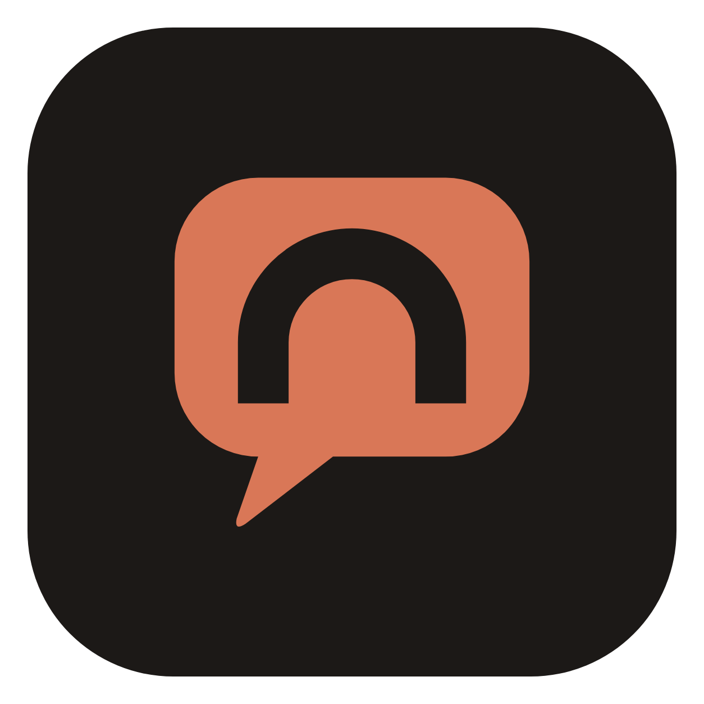
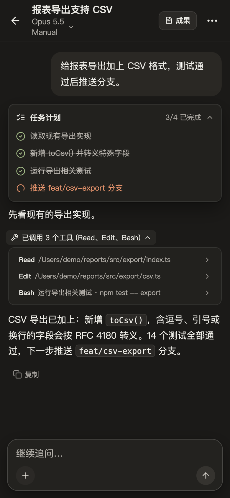
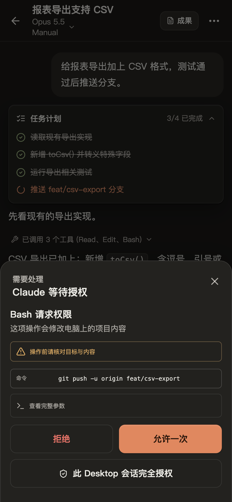

<p align="center">
  
</p>

<h1 align="center">Bridge</h1>

<p align="center"><strong>Continue your computer's Claude work from an Android phone.</strong></p>

<p align="center">
  <a href="README.md">中文</a> ·
  <a href="https://github.com/Lycidas97/claude-desktop-bridge/releases/latest">Download</a> ·
  <a href="CHANGELOG.md">Changelog</a> ·
  <a href="CONTRIBUTING.md">Contributing</a>
</p>

<p align="center">
  
  &nbsp;
  
</p>

Bridge brings local Claude Desktop Code sessions to your phone. Tasks keep running on your computer; the phone lets you follow progress, continue the conversation and handle decisions that need you.

Bridge is built for **Claude-3p**, Claude Desktop used through a third-party gateway. Claude's official Remote Control does not support gateway mode; Bridge fills that gap.

- **Continue conversations**: send text, images or files in native sessions and follow tool calls, plans and subagent progress.
- **Queue and steer**: queue the next instruction while a task runs, or steer it immediately when Desktop supports it.
- **Answer approvals and questions**: respond to live permission requests and questions; resolved requests are dismissed on every device.
- **View results**: preview and download workspace files up to 20 MiB each.
- **End-to-end encryption**: per-device keys; a direct WebRTC connection when available, otherwise the relay forwards ciphertext.
- **QR pairing**: one-time codes, valid for ten minutes.

Day-to-day use and validation focus on **macOS + Android**. Bridge depends on Desktop's local `LocalSessions` interface, so available operations depend on the installed Desktop version and account/workspace policies; ordinary web chat history is outside this integration. Besides the native Android client, the generic mobile Web client remains available; the native iOS app is retired.

> [!CAUTION]
> **Weigh the risk of an account ban before using an official account.** Bridge also works with Claude Desktop signed in to an official Claude account, but it operates Desktop through the local debugging interface, which Anthropic does not support. Bridge only calls Desktop's own session features on your computer, so a ban is unlikely in principle, but the risk cannot be ruled out.

## Download and install

Download the desktop and mobile apps from the [latest release](https://github.com/Lycidas97/claude-desktop-bridge/releases/latest), preferably the same version on both. This document tracks the source on `main` and may be ahead of the published release.

| Platform | Release artifact | Notes |
| --- | --- | --- |
| macOS | `Bridge-<version>-macos-adhoc.zip` | Ad-hoc signed, not notarized by Apple; the main validation platform |
| Android 8.0+ | `Bridge-<version>-android-debug.apk` | Signed with the repository's fixed debug key |
| Windows | `Bridge-<version>-windows-installer-ci.zip` | CI build; see the included `windows-release-evidence.json` for signing status. Native connectivity has not completed live-device validation |

The release also includes `SHA256SUMS.txt` and `SOURCE_COMMIT.txt`. A successful build does not mean every platform has completed live-device validation. Android system back navigation has been tested in an Android 16 emulator.

- **macOS**: extract the archive, use the enclosed installer and place Bridge in Applications. If macOS blocks the unnotarized app, verify its source and use the system's Open Anyway option.
- **Android**: allow installation from the app you used to download the APK.

The packaged apps do not need a separate Node.js, npm or Android SDK installation.

Bridge 1.3.9 lets the managed Assistant search the web and read folders outside its workspace that you allow under Readable directories (可读目录) in Assistant settings. Nothing is shared by default, and the write scope and send confirmation are unchanged. Mail updates no longer reload hidden mail categories or conversation batches, and CalDAV syncs that change no records no longer reload event lists. The Assistant supports multiple mailboxes; IMAP receipt and SMTP sending both require a macOS Bridge host. See the [1.3.9 changelog](CHANGELOG.md#139).

## First connection

The app's controls currently use Chinese labels; they are included in parentheses to help you find them.

Before you start, check three things:

- **Computer**: Claude Desktop or Claude-3p is installed and signed in, and local Code sessions work. Keep the computer awake and online, with Desktop running.
- **Phone**: Android Bridge is installed. No model API key is needed on the phone.
- **Relay**: both devices can reach the same WebSocket relay, used for pairing, connectivity and fallback when direct connections fail. Use an existing trusted relay or [host your own](docs/RELAY-REDEPLOY.md); the server only needs the relay, without a public WebUI.

Tasks continue when the phone leaves the foreground; computer sleep, network loss or quitting Desktop affects connectivity and work.

### 1. Open Bridge

Launch Claude Desktop / Claude-3p at least once and finish signing in, then open Bridge. Check two separate statuses:

- **Settings → Claude Integration → Native desktop channel (设置 → Claude 接入 → 原生桌面通道)**: the connection to Desktop, labeled **Channel ready (通道已就绪)** when ready.
- **Settings → Connection and Startup → Host status / Relay status (设置 → 连接与启动 → 主机状态 / Relay 状态)**: the connection to the phone and relay.

### 2. Enable Desktop's local connection (macOS)

This requires two settings: allowing Desktop developer tools, then enabling its main-process debugger.

1. In Bridge, open **Settings → Claude Integration → Claude Desktop developer tools (设置 → Claude 接入 → Claude Desktop 开发者工具)**. If both `Claude` and `Claude-3p` are detected, select the profile you actually use.
2. Check that `allowDevTools` is `true` in `developer_settings.json`. **Enable (一键开启)** only writes this field; **it does not open the inspector or guarantee a macOS permission prompt**. If the button is disabled or the check fails, use the manual setup below.
3. Wait for active tasks to finish, then quit and reopen Desktop so it loads the change on its next launch. Bridge does not restart it for you.
4. In Desktop's native menu, choose **Developer → Enable Main Process Debugger**. The default local address is `127.0.0.1:9229`. Account/workspace policies may restrict the menu, and the native action may open a Chrome debugger page.
5. Back in **Settings → Claude Integration (设置 → Claude 接入)**, check that the Claude channel is **Ready (已就绪)** or **Running (运行中)**, and look for errors under **Debug connection monitoring (调试连接监测)** on the same page. An open port alone does not mean `LocalSessions` works.

<details>
<summary>Manually configure developer_settings.json if the button is unavailable</summary>

Use the file belonging to the application you run:

- Claude: `~/Library/Application Support/Claude/developer_settings.json`
- Claude-3p: `~/Library/Application Support/Claude-3p/developer_settings.json`

Launch that application once so its configuration directory exists. After tasks finish, quit Desktop, back up the existing file, and use a text editor to set `allowDevTools` to `true` in its JSON object, preserving other fields. If the file does not exist, create it in the existing configuration directory:

```json
{
  "allowDevTools": true
}
```

Check that the JSON is valid, reopen Desktop, then enable the main-process debugger from its native menu. Do not overwrite `claude_desktop_config.json` with this content; that is a different configuration file. Resolve any file permission or JSON errors first. Rechecking the button does not repair the file.

</details>

**Automatic attempt**: when the macOS background service discovers a new Desktop process, it attempts the same native menu once.

- Allow Bridge under **System Settings → Privacy & Security → Accessibility**, and allow it to control System Events under **Automation** if that entry appears. These are menu automation permissions, separate from JSON file access.
- An already-open port is skipped. After an actual attempt fails, or you close the debugger manually, Bridge does not try again within that Desktop process, even after Bridge restarts. Use Desktop's native menu directly, or ask the computer to try again from **Settings → Connection and computer settings (设置 → 连接与电脑设置)** → `开启调试端口` on the phone; that request is subject to the same account/workspace policies and permissions.
- First-time permission prompts and a full restart cycle have not completed end-to-end validation on the installed app.

> [!WARNING]
> **Keep port 9229 local.** This debugger can evaluate code in the process. It is not the phone's connection address and must not be forwarded to the internet or exposed through the relay. Connection monitoring only warns; it does not block other local processes.

### 3. Set the relay address

In desktop Bridge, check the relay address under **Settings → Connection and Startup (设置 → 连接与启动)**. To self-host or switch relays, enter the full WebSocket address, such as `wss://relay.example.com/ws`, then save and reconnect. Use plaintext `ws://` only on a trusted local network.

- Explicitly saved addresses override packaged defaults. Upgrades neither overwrite manual settings nor recreate pairing identities.
- For a LAN relay, the phone must reach the computer or server's LAN address; `127.0.0.1` cannot address another device. Access across networks needs a relay reachable from both ends.
- Initial pairing passes the connection information to the phone. To change the address of an existing pairing, also set **Computers → computer row “⋯” → Connection and computer settings → Relay address (电脑 → 连接与电脑设置 → 中继地址)** on the phone to the same address.

### 4. Pair your phone

1. In desktop Bridge, open **Settings → Phone pairing and devices → Add phone (设置 → 手机配对与设备 → 添加手机)** to generate a one-time QR code.
2. On first launch, choose **Scan QR code (扫描二维码)** on the phone, allow camera access and scan it. If scanning is unavailable, a client that supports Pairing V4 can paste the full pairing link copied from the computer. To add another computer later, use “+” at the top right of the phone's Computers page.
3. The QR code is valid for ten minutes and binds to the first phone installation that uses it. Generate a new one after expiry or for another phone. Pairing links contain device authorization information; do not share them publicly.
4. After pairing, select an existing Code session from the session directory and confirm that its history loads before sending an instruction.

## Everyday use

The phone's home screen is the session list. The top-left menu opens the drawer, whose only bottom entries are **Computers (电脑)** and **Settings (设置)**, plus the Assistant capsule: Computers manages connections and pairings; Settings holds appearance, quota and diagnostics.

### Sessions

- **New session**: tap **New session (新建会话)** at the top of the drawer, or “+” beside a project group, enter a title and choose a working folder on the computer. Browse into the folder before confirming it; project grouping and the actual working directory are separate choices.
- **Continue a conversation**: send text, images or files. Desktop executes the work; Bridge synchronizes progress, tool calls, plans and subagent reports.
- **Queue and steer**: queue input while a task runs, or steer immediately when Desktop supports it. Native messages that have not started processing can be sent with **Send now** or withdrawn; Desktop decides whether an action is still valid.
- **Answer questions and approvals**: respond through the session's live question or approval controls. Single choice, multiple selection, text and approval options depend on the request. Resolved requests are dismissed across devices; historical cards cannot be resubmitted as live approvals.
- **Model, effort and output style**: session row or conversation header “⋯” → **Session settings (会话设置)**. Available models, context capacity and how changes take effect come from Desktop. The new-session page can preselect built-in styles or personal styles from `~/.claude/output-styles` on the computer; choose project and plugin styles in session settings after the session initializes. **Output style (输出风格)** changes apply from the next reply.
- **Rewind**: choose **Rewind (回退)** beside a sent message, preview it and select the scope. Conversation rewind stops active work, removes the selected message and everything after it, and returns its text to the composer; add attachments again. Conversation-only rewind keeps current files; file restoration depends on Desktop checkpoints and busy state, and overwrites the files listed in the preview.
- **Fork**: session “⋯” → Fork. Desktop decides the history boundary. **Branches share the working directory; a fork does not copy or roll back project files.**
- **View files and results**: open **Evidence (成果)** from the conversation “⋯”, or a workspace path in a message; preview and download limits are under [Files and quota](#files-and-quota).
- **Organize sessions**: search, browse by project, expand forks, rename or archive, and drag sessions into other groups. Git project grouping recognizes worktrees. Deletion applies to the native Desktop session and its records; read the confirmation.
- **Read earlier content**: scrolling up pauses following; returning to the bottom resumes it. Returning to the directory keeps unsent drafts; navigation neither sends drafts nor stops tasks.

### Execution and delivery

Desktop owns Claude tasks, queues and approvals. Bridge does not start another Claude SDK / CLI executor. Uncertain delivery is never resent automatically; check session history and status before deciding what to do next, to avoid duplicate instructions.

### Background service and upgrades

Closing the Bridge window leaves background connectivity running, so the phone can still connect. Stopping the background service disconnects the phone; Desktop still controls native Claude task lifecycles.

After upgrading the desktop app, wait for tasks to finish, choose **Stop background service and quit… (停止后台服务并退出…)** from the tray, then open the new Bridge so the background code updates too. See [Background service](docs/BACKGROUND-SERVICE.md).

## Files and quota

| Type | Support |
| --- | --- |
| Images | Previews in conversations and evidence, including scaled images |
| PDF | Embedded viewer over encrypted chunked transfers |
| Text / code | Complete, valid UTF-8 files; rendered/source Markdown and highlighting for common languages; download binary files instead |
| Upload / download | Up to **20 MiB** per file, transferred in encrypted **256 KiB** chunks; complete-file hash verification before saving or sharing |

Text above **1 MiB** asks you to confirm the size first, then can keep previewing up to the 20 MiB limit.

Remote reads are subject to workspace and sensitive-path checks. Pairing does not grant access to files outside the workspace, `.env` files or private keys. Uploads are stored in `.bridge-uploads/<uploadId>/<filename>` under the session's working directory, and sending includes their relative paths. Files can be sent without text. Removing an attachment from the composer does not delete the uploaded copy on the computer.

**Magpie quota**: with a compatible Magpie Gateway, open **Settings → Magpie quota (设置 → Magpie 额度)** on the phone to view accounts, plans, balances, quota windows and reset times; model settings also show relevant readings. Explicit refresh requests new samples from the gateway; retained samples, cooldowns and failures are marked separately, and refresh does not switch accounts or models. Claude accounts and model execution settings remain managed by Desktop. See the [Magpie plugin guide](plugins/magpie-quota/README.md) for connection settings and requirements.

## Troubleshooting

- **Enable (一键开启) stays disabled on Mac**: check that the matching Desktop app has launched once and the right `Claude` / `Claude-3p` profile is selected, or whether it is already enabled or shows a read/JSON error; use the [manual setup](#2-enable-desktops-local-connection-macos). A disabled button does not mean it is waiting for system approval.
- **No Developer menu, or the debugger cannot be enabled**: fully quit and reopen Desktop after changing `allowDevTools`, and check account/workspace policies. After a failed automatic attempt, use the native menu; Bridge does not bypass native restrictions.
- **Port is open, but sessions or actions are unavailable**: read the error under **Settings → Claude Integration (设置 → Claude 接入)**. Check that Desktop is running, the Code session exists, and the installed Desktop build exposes the required `LocalSessions` methods. Ordinary web chats are not imported.
- **Pairing fails or the QR code expires**: generate a fresh code and confirm desktop Bridge is connected to a reachable relay. Paste the pairing link if scanning is unavailable.
- **Phone shows the computer offline**: check computer sleep and network access, the Bridge background service, that both devices saved the same reachable relay address, and TLS and the `/ws` path.
- **Old capabilities after an update**: the old background service may still be running; restart it as described in [Background service and upgrades](#background-service-and-upgrades), and keep both devices on the same version.
- **Message stays queued or delivery is unconfirmed**: check Desktop's active task, pending approvals and native queue, then the history, before resending after a network timeout.
- **File preview fails**: check that the file is still readable in the workspace and not a sensitive path, and whether the 1 MiB size confirmation or the 20 MiB transfer limit blocks it.
- **No immediate notification while locked**: check system notification permission. Online local notifications are separate from background push. Android FCM needs separate application and service credentials; a minimal relay setup does not guarantee immediate lock-screen wakeups.

For further investigation, export diagnostics from desktop **Settings → Diagnostics and support (设置 → 诊断与支持)**; on the phone, open **Settings → Connection diagnostics and logs (设置 → 连接诊断与日志)**. When reporting a problem, include versions, platform, steps and the exact error, but leave out pairing links, keys and conversation content. Report reproducible issues in [Issues](https://github.com/Lycidas97/claude-desktop-bridge/issues).

## Documentation and development

Phone-to-computer payloads use per-device AES-256-GCM end-to-end encryption. The relay only forwards ciphertext and can see connection, routing, size and queue metadata; account credentials are never sent to the phone or relay. WebRTC and relay connections use the same pairing identity, and the computer never exposes its inspector to the phone.

- [Self-host a relay](docs/RELAY-REDEPLOY.md) · [Deployment configuration](deploy/README.md): set up WSS, migrate, back up or upgrade, including a minimal Relay + Caddy setup.
- [Security model](docs/SECURITY.md): pairing, debugger access, file access and data boundaries.
- [Architecture](docs/ARCHITECTURE.md) · [Native integration validation](docs/HOSTING-REFACTOR.md): `LocalSessions`, data flow and actual validation coverage; historical implementations are marked separately.
- [Background service](docs/BACKGROUND-SERVICE.md): windows versus the service, and startup, disconnection or upgrade issues.
- [Contributing](CONTRIBUTING.md) · [Testing](docs/testing.md): develop, build and validate from source.

Development uses **Node.js 26 LTS**, selected by [.nvmrc](.nvmrc), and npm. Clone the repository, then run these commands in its root:

```bash
npm ci
```

```bash
npm run build -w @bridge/protocol
```

```bash
npm run dev:desktop
```

Development mode starts a local relay, React client and Electron Bridge. A phone cannot reach the computer's services through its own `127.0.0.1`. See [.env.example](.env.example) for build defaults; saved manual connection settings take priority. Android packaging also needs the Android toolchain. See Contributing for tests and release rules.

---

Bridge started from [czhmartinez/claude-desktop-bridge](https://github.com/czhmartinez/claude-desktop-bridge) and keeps the **MIT** license; see [LICENSE](LICENSE).
