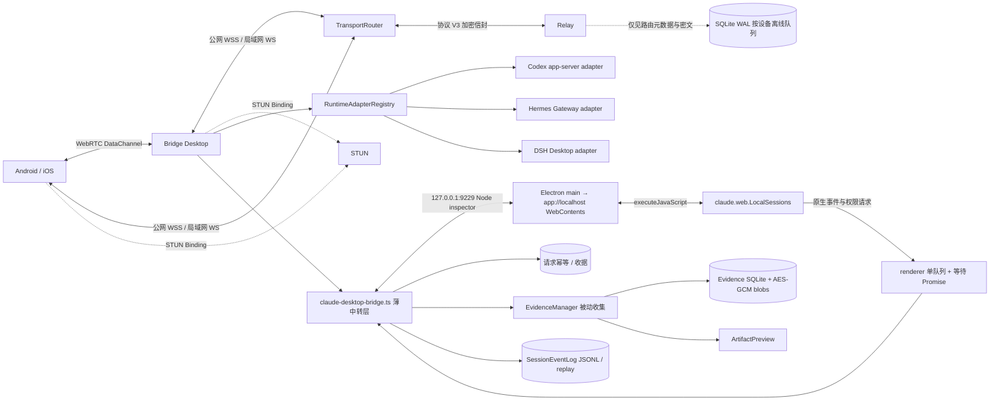
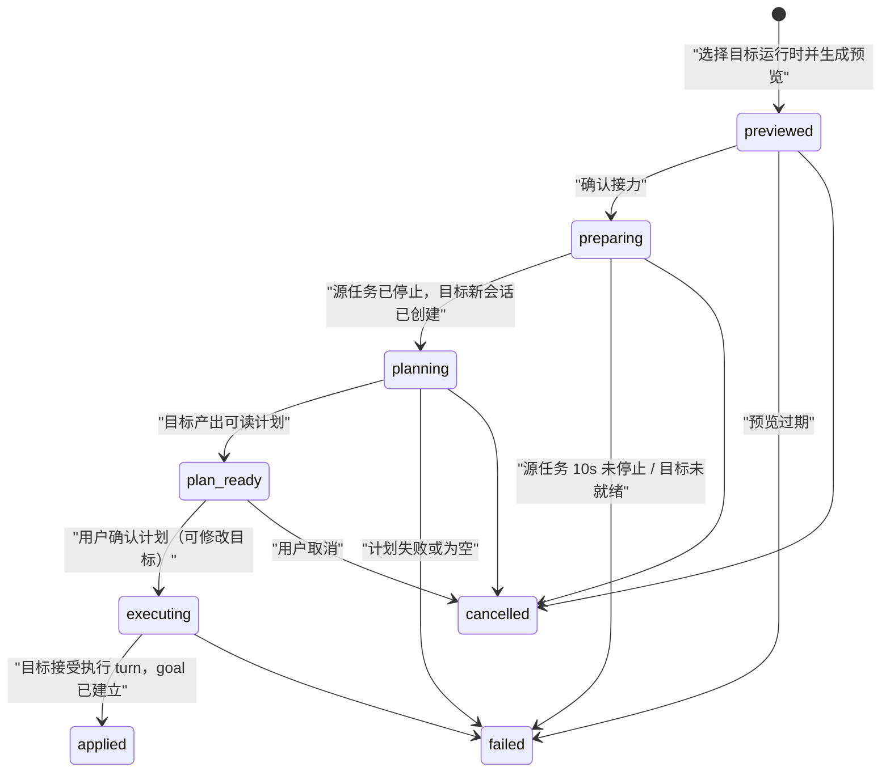
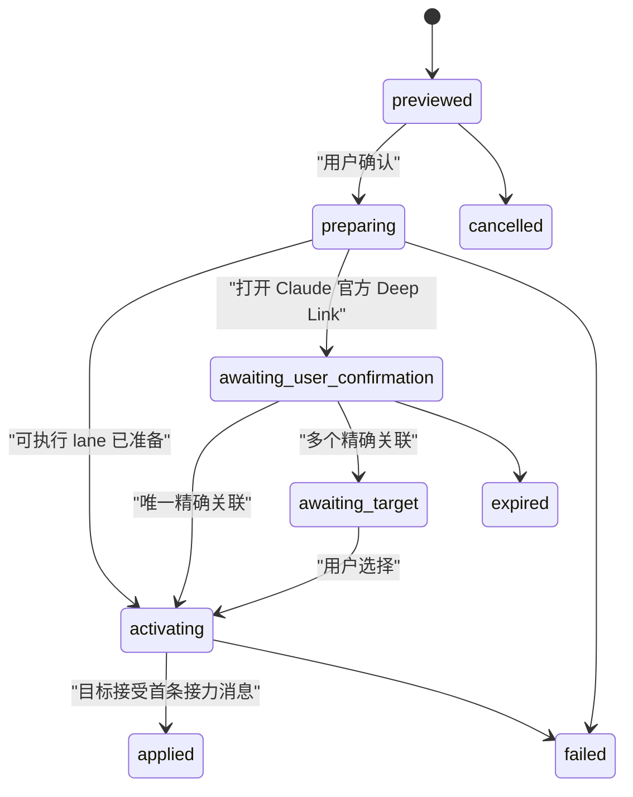
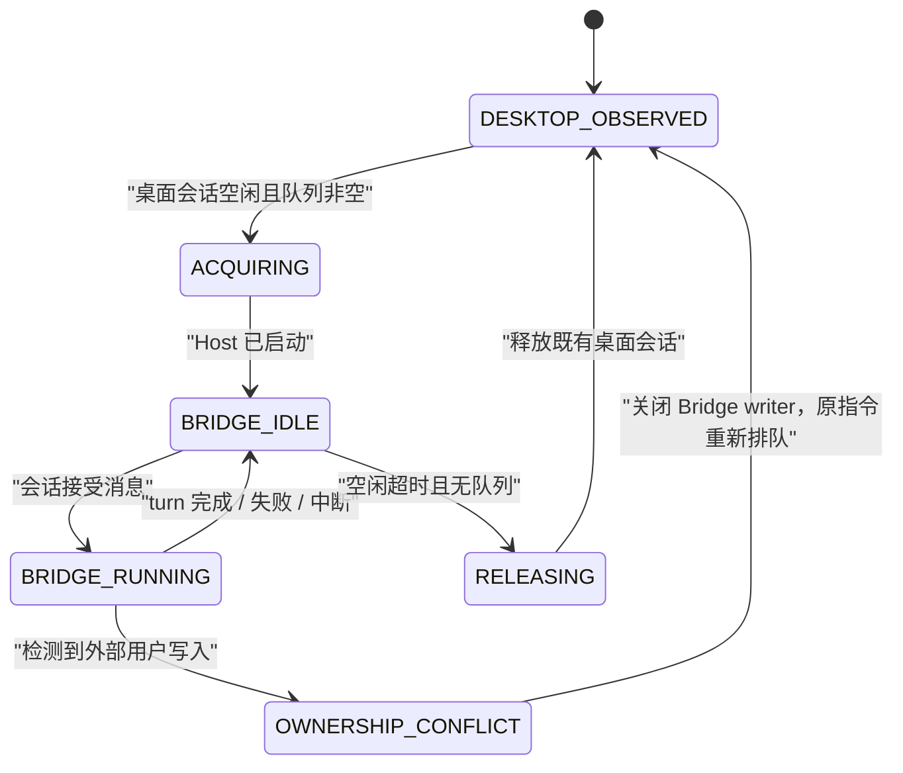

# Bridge 架构

本文描述当前分支的 Claude 原生接入；旧 Host/lane/所有权流程在对应章节标为历史。macOS 已通过真实 Desktop 的创建、发送、原生事件、历史及关闭 Bridge 后会话保留验证；尚未打包发布，具体验证范围见[重构记录](HOSTING-REFACTOR.md)。

## 产品边界

Bridge 是独立的多 Desktop 协作产品，不是远程桌面，也不是任何一个 Desktop 输入框
自动化。它统一手机与桌面上的会话列表、发送、流式输出、工具状态、审批、追问、中断和
恢复体验；Claude Desktop、Codex Desktop、Hermes Desktop 与 DSH Desktop 的账户、原生
会话、模型、权限与历史始终各自独立。Claude 由 Desktop 原生接口执行，Bridge 不再启动
第二套 Host，也不接管或交还会话；旧 lane 和接力流程仅保留为历史记录。
Bridge 只建立出站连接，不要求公网 IP、端口映射或额外组网客户端。

## Claude 原生接入

新 `claude-desktop-bridge.ts` 是薄中转层，Claude Desktop 是会话执行、队列和权限的
唯一权威。Bridge 从用户已开启并选择常开的 `http://127.0.0.1:9229/json/list` 动态
取得 Node inspector 的 `webSocketDebuggerUrl`，经 `process.mainModule.require('electron')`
定位 `app://localhost` WebContents，再以 `executeJavaScript` 调用
`claude.web.LocalSessions`。会话创建、发送、排队、中断和权限答复均走原生接口，
不再启动 SDK/CLI Host 或 standalone API Key lane，也不使用接管/交还、inbox、Claude
lane、自动 goal 续跑或侧边栏文件登记。

事件与权限请求订阅进入 renderer 中同一队列；无事件时等待 Promise，收到事件后
批量返回，由 Bridge 记录事件并向客户端 replay。Bridge 保留配对、E2EE Relay/WebRTC、
请求幂等与收据、附件传输和证据被动收集，不把事件转发变成第二套会话调度。

用户本次选择覆盖旧“绝不 CDP / 不附着”的 Claude 限制；不改 asar、不签 token、
不重启 Desktop、不加 LaunchAgent 或辅助功能菜单自动化。inspector 未开启时显示
不可用；Relay 不暴露任意 evaluate，也不传账号凭据。macOS 已实测空会话创建、发送、
原生生命周期事件、历史、请求去重与正常关闭；原生审批和子代理停止尚未对真实 Desktop
做端到端验证。

Claude 直接使用 Desktop 返回的原生会话 ID，历史分页直接调用 Desktop transcript
接口。旧 Bridge 本地隐藏/归档标记不覆盖原生列表；重命名、归档和删除交由 Desktop，
删除确认明确说明将删除 Desktop 中的会话与对话记录。不导入旧数据、不映射旧逻辑 ID，
也不从本地旧历史或 eventlog 回退补页。旧数据
不碰，不从旧队列恢复草稿；手机缓存的 `bridgeExecutionRequested` 不得自动重发。
`removeLegacyConnector` 仅用于退役旧连接组件：先写 `.bridge-backup`，再清理旧
`claude-bridge` MCP、固定
`BRIDGE_HOOK_URL` 及动态 `http://127.0.0.1:<port>/hooks/claude-permission` 中同时带有
`X-Bridge-Permission-Host: $BRIDGE_PERMISSION_HOST` 与 `allowedEnvVars` 包含
`BRIDGE_PERMISSION_HOST` 的 HTTP Hook；无关 Hook、MCP 和设置保留。

## 0.6 多 Desktop 运行时

统一对象是操作体验，不是对话本体。Claude 对外直接使用 Desktop 返回的原生
`sessionId`，不建立旧逻辑 ID 的 alias。Codex、Hermes、DSH 保持现有
`(runtimeId, nativeSessionId)` 身份与编码方式，例如 `codex-desktop:<native-id>`；
不同运行时的会话不会被放进同一段上下文。

| 运行时 | 本地适配方式 | Bridge 可统一的操作 | 明确边界 |
|---|---|---|---|
| Claude Desktop | 用户已开启的 Node inspector → WebContents → `claude.web.LocalSessions` | 原生会话操作、队列、事件、权限与被动证据（实测范围见重构记录） | Desktop 唯一执行权威；无 Host、lane、接管或自动 goal |
| Codex Desktop | Bridge 自己启动的本地 `codex app-server --stdio` | 会话、发送、steer、流、工具、审批、追问、中断 | 不附着或篡改已运行 Desktop 进程；不共享 Claude/Hermes 历史或授权 |
| Hermes Desktop | Bridge 自己启动的仅环回 Hermes Gateway，使用进程级随机令牌 | 会话、发送、steer、流、工具、审批、追问、中断 | 不读取 Desktop token/keychain；不接受非环回 Gateway 地址 |
| DSH Desktop | 附着正在运行的 DSH 宿主：`/api` 一元 RPC + `events.mux`/`events.host` 双下行流（DSH 自带回环信任栅栏） | 会话、发送、queue/steer、流、工具、审批、追问、中断、模型配置、图片附件 | 只认回环权威（Host 头），不读取 DSH 凭据；`BRIDGE_DSH_GATEWAY_URL` 可显式指定宿主 |

## 1.0 DSH Desktop 运行时

DSH Desktop（DeepSeek Harness）的宿主自带一个回环 web server：一元调用走
`POST /api/<method>` 的 `client-request` 信封，事件走 `/api/events.mux` 与
`/api/events.host` 两条只下行 WebSocket，就绪契约要求 `host.describe` 成功且两条
流都已打开。宿主监听 OS 分配的随机回环端口，Bridge adapter 的发现路径是
「按进程名找 PID → 枚举其监听端口 → 逐一探测 `host.describe`」；已安装未运行时先
拉起应用再等宿主上线，连接中断后按 15 秒节奏重发现。审批与追问复用宿主自己的
pending 表：`approval/requested`、`question/requested` 帧携带宿主铸造的 rpcId，
应答经 `/api/respond` 回投（取消即 `ok:false` 的 client-response）。文本增量按 token
到达，adapter 聚合后才发往中继；reasoning 与 tool-call 增量永不出站。

原生运行时轮次使用统一的被动证据管线，不为采集证据启动 Claude Host：
`turn.started` 开立 bundle、`tool.*` 记录真实起止、工作区归因文件变化、
`turn.completed` 收口并写入运行时上报的聚合 token 用量（DSH 按 step 上报，按轮
累加）。成果栏因此对所有运行时一致：轮次编号、真实耗时、总览时间轴与工具检查器，
进行中的记录只显示开始标记，不虚构耗时。

`RuntimeAdapterRegistry` 只注册能力和健康状态，`RuntimeSessionBroker` 只做协议归一化、
事件落盘与权限路由，不执行会话迁移，也不为某个 Desktop 自动故障转移到另一个 Desktop。
统一会话列表只是索引；打开后始终回到拥有该任务的原生运行时。Claude 不再参与旧 Host
接力或 Bridge 自动 goal 续跑；旧流程见下方历史章节。

各 adapter 必须显式声明能力。当前共同基线为 `session.list/create/history`、
`turn.start/steer/interrupt`、`permission.resolve` 和 `tool.events`；图片附件按 adapter
能力单独开放；Codex/Hermes 的模型、provider、思考强度和快速模式通过 adapter 的
`session.configure` 调用各自 Desktop 的原生会话配置接口。Bridge UI 对所有 ready runtime
提供相同的会话、流、审批和中断操作，并在任务标题和筛选器中显示其归属。

两个外部运行时都把「新建但未发过消息」的会话只保存在内存里：Codex 线程在首个用户消息
落盘 rollout 前不出现在 `thread/list`，且 `thread/read`/`thread/resume` 直接报错；
Hermes 懒会话只接受创建时返回的临时别名（`prompt.submit`、中断、历史与全部推送事件都
走别名），`session.resume` 只认持久化后的 `stored_session_id`，落盘后的 `session.list`
行也只带 stored id。adapter 因此显式跟踪「未物化线程 / 存活别名」：历史按空返回、首轮
跳过 resume 直发、刷新时保留原生侧还列不出的会话。Hermes 的公开会话身份始终是 stored
id——它是 `session.list` 返回的唯一稳定值，Bridge 重启后手机端引用不会漂移；别名
只在网关进程内做活操作句柄，网关事件按别名映射回 stored id。控制器
按 sessionId 的运行时归属路由，不再依据 adapter 缓存命中，避免瞬时未命中回退到错误
Broker。

手机端会话列表依赖全量快照：事件增量只更新已存在的会话，不会新增。Bridge 在每次发布
时比对会话 id 集合，新增/移除原生会话时向已配对设备推送全量重同步，后续状态通过
事件与 replay 更新；同步不会恢复旧 Claude 队列、接力或自动 goal 执行。

## 组件

| 组件 | 职责 |
|---|---|
| `claude-desktop-bridge.ts`（新薄中转层） | 通过本机 inspector 转发 `LocalSessions` 调用、renderer 单队列事件与权限请求 |
| `RuntimeAdapterRegistry` | 各原生 adapter 的发现、状态与能力注册 |
| `RuntimeSessionBroker` | `(runtimeId, nativeSessionId)` 隔离、原生事件与审批的归一化 |
| `CodexAppServerAdapter` | 仅通过 Bridge 自己启动的官方 app-server JSON-RPC 访问 Codex 会话 |
| `HermesGatewayAdapter` | 仅通过本机环回 Gateway 访问 Hermes 会话，并持有进程级临时令牌 |
| `DshDesktopAdapter` | 通过宿主回环 `/api` 与原生事件流访问 DSH 会话 |
| `ConversationStateStore` | 保存新原生请求的幂等键与收据，不导入旧数据 |
| `SessionEventLog` | 追加式事件、单调 `seq`、delta 合并与 replay，不作为 Claude 历史回退源 |
| `EvidenceManager` | 每轮证据生命周期、工具脱敏、变更归因、预览和传输租约 |
| `EvidenceStore` | SQLite 清单、加密内容寻址快照、保留策略和按需重建 |
| `ArtifactPreview` | 图片缩放和隔离、禁网的 HTML 静态截图 |
| `packages/protocol` | 请求/响应/事件/证据/快照、AES-GCM、设备定向 ACK |
| `BridgeTransport` | 公网与局域网使用同一 Envelope、ACK、幂等和事件 cursor |
| `WebRtcTransport` | 加密信令、五秒直连竞争、DataChannel 分块、ACK 与无缝回退 |
| `apps/relay` | 鉴权、SQLite 离线密文、分块、撤销、指标、备份和无正文推送 |
| `apps/client` | 手机三层导航和电脑轻量控制台 |

## 跨 Desktop 串行接力（0.7，历史）

> 本节保留旧实现说明；涉及 Claude 接力、lane 和 Bridge 自动 goal 续跑的路径已退出当前架构，不作为原生接入或重启恢复规则。Codex、Hermes、DSH 的原生接入保持不变。

跨运行时接力由独立的 `RuntimeHandoffService` 编排，与 Claude 域内 lane 接力并行且
互不改写。它把「接力」建模为源会话到目标新建会话的**有向链接**，而不是任何意义上的
会话迁移：原生身份 `(runtimeId, nativeSessionId)` 不变，目标会话由目标运行时自己执行，
Bridge 只在两次用户确认之间传递接力包。

- **预览**：`runtime.handoff.preview` 构建加密接力包（目标草稿、有界近期对话、约束、
  未完成事项、工具/成果摘要、workspace git 状态、完整性哈希），与 0.5 lane 接力包共用
  同一套 compact/redact/workspace 采集实现（`handoff-package.ts`）。提示词上限仍为
  48,000 字符；预览 30 分钟过期。
- **确认接力**：源会话运行中先 `interruptTurn` 并有界等待 10 秒；未停止则失败且源任务
  保持原状。源队列中未发送项不迁移，仅以摘要进入未完成事项。目标会话以源 cwd 新建，
  标题为「接力自 <源标题>」。
- **计划阶段**：Codex 目标经 `thread/settings/update` 设 `collaborationMode: plan` 原生
  只读规划；Claude/Hermes 目标使用只读规划约定（写操作仍走既有审批）。计划 turn 的
  终稿 assistant 消息存为计划文本；空计划直接失败。
- **goal 执行**：用户确认计划后，Codex 目标调 `thread/goal/set` 建立原生 goal 并恢复
  default 模式，由运行时自动续跑；Claude/Hermes 目标执行带 `GOAL_STATUS:
  continue|done|blocked` 约定的指令，Bridge 在每轮结束解析标记并自动续跑（上限 20 次，
  持久化计数），done/blocked 分别进入完成/受阻。
- **停止语义**：用户在目标会话停止任务会同时暂停 goal（Codex 原生 `paused`，模拟侧停
  循环），goal 循环永不与用户停止对抗；`runtime.goal.pause/resume` 可显式控制。
- **故障闭合**：Host 重启后 `preparing` 与无 goal 的 `executing` 直接失败（绝不重发），
  `planning` 从目标历史恢复可读计划（否则失败），`applied` 的 goal 按 `runtime_goals`
  恢复监督并与 Codex `thread/goal/get` 对账。

接力状态持久化在 `conversation-state-v1.sqlite` 的 `runtime_handoffs` 与
`runtime_goals` 两表；接力链（`BridgeSessionInfo.relay`）、goal 状态
（`BridgeSessionInfo.goal`）与待确认接力（`pendingRuntimeHandoff`，快照中剥离计划
全文与原生 ID）作为增量快照字段下发。协议仍为 V3、配对 schema 仍为 V4，新增
`runtime.handoff.v1` capability 与 `runtime.handoff.*`/`runtime.goal.*` 方法事件，
旧客户端忽略并隐藏入口。

## Claude 域内逻辑对话与提供方接力（历史）

> 以下仅记录旧 provider lane 的设计。当前不导入旧数据、不建立逻辑 ID alias，也不提供旧历史入口；直接读取 Desktop 记录，旧文件不碰。

本节只描述 Claude 运行时内的 legacy provider lane。`BridgeSessionInfo.sessionId` 是稳定逻辑对话 ID。每个对话可以保留多个
`BridgeExecutionLane`，但 `conversations.active_lane_id` 始终只指向一个活动 lane。
原生会话唯一键为 `(providerProfileId, nativeSessionId)`，避免 Claude 与 Claude-3p
恰好出现相同原生 ID 时被错误合并。队列项在入队事务中固定 `laneId`，后续切换不会
把已排队指令偷偷改投其他 provider。

`preview` 只生成本机加密包并把 route 标为切换中，不改变活动 lane。可执行 lane 只有
在 `user.message.accepted` 确认接力首条消息后才原子激活；断电恢复时处于
`preparing/activating` 的接力直接失败并取消未确认队列，绝不自动重发。Claude 官方
必须同时满足 official profile、`realpath` cwd、不透明 handoff ID、首条消息完整
哈希与十分钟窗口；零匹配继续等待，多匹配进入人工选择。

完整接力包只在 Host 本机以 AES-256-GCM 保存。它包含有界可见对话、明确目标、用户
约束、未完成事项、工具/成果摘要、文件与哈希、cwd、Git HEAD/分支/脏状态、源事件
序号和完整性哈希；不包含隐藏思维、OAuth/API Key/认证头、敏感正文、项目外内容或
无界输出。Agent SDK 提示上限 48,000 字符，官方 Deep Link 上限 12,000 字符。

本次原生重构不导入或改名旧 `sessions-v2.json`、`turn-queue-v2.json`，不恢复其中的
队列或草稿；旧文件不碰。

## 会话所有权（历史）

> 下方状态机属于旧 SDK/CLI Host 接管流程。当前 Claude 执行、队列与权限始终由 Desktop 持有，Bridge 不启动 writer、不退出原生执行器，也不重新排队自动续跑。

同一会话只允许一个实际写入者，但 Claude Desktop 的空闲会话进程可以作为只读
观察者与 Bridge Host 共存。打开、聚焦或查看会话只改变 Desktop 元数据，不会触发
冲突，也不会导致 Bridge 退出 Claude Desktop。Bridge 启动 Host 前会确认目标
transcript 已空闲并到达完成边界。

Host 启动时记录外部写入版本。`TranscriptObserver` 扫描全部近期用户分支，只有出现
无法归因给 Bridge 的新用户消息时才确认竞争写入；进程存在、文件句柄和 focus 变化
都不是写入证据。检测到真实双写时，Bridge writer 会静默关闭，原指令保持排队并在
所有权清晰后自动续跑。主机最多同时运行两个 Bridge turn。瞬态会话锁仅在消息尚未
被会话接受时重试，避免重复执行。

## 历史与事件

Claude 会话与历史直接通过 `LocalSessions` 原生接口读取，历史默认最近 50 条，
向上使用 Desktop transcript cursor 分页。原生会话 ID 保持不变；不关联旧逻辑会话，
也不回退到本地旧 JSONL 或 Bridge eventlog，Desktop 不可用时明确显示不可用。

Bridge 自身事件写入 `events-v2.jsonl`，高频 assistant delta 短时合并。客户端保存
最后 `seq`，重连后调用 `events.resume`；事件 replay 与原生历史分页分开。Relay ACK
只表示密文已保存或目标设备已收到；接收、运行和最终状态以 Desktop 原生事件为准。

## Claude Desktop 侧边栏登记（历史）

> 以下文件登记与重启说明仅记录旧方案；当前通过 `LocalSessions` 操作原生会话，不登记文件，不为 Bridge 重启 Desktop。旧“私有 CDP”禁用规则已由本次用户选择在上述本机边界内覆盖。

Bridge 只为自身创建、且已经有可信 JSONL 的会话登记侧边栏。登记器在 macOS 使用
`ps`、在 Windows 使用 PowerShell，从 Claude 主进程及其 Helper 的
`--user-data-dir` 动态识别当前 profile，不硬编码 `Claude-3p`；Windows 使用
`%APPDATA%\Claude\claude-code-sessions` 作为标准会话根目录。
随后要求本机仅有一个可识别的账号会话目录，并用现有 `local_*.json` 验证格式。

目标 Desktop ID 固定为 `local_<Bridge sessionId>`。写入前同时校验 transcript 位于
`~/.claude/projects`、记录中的 `sessionId` 与 `cwd` 一致、目标路径位于已知
`claude-code-sessions` 根目录，并拒绝符号链接、路径逃逸和同名冲突。新文件通过
临时文件加硬链接原子创建，权限为 `0600`，从不覆盖已有元数据。

登记事件只向客户端暴露状态、说明、Desktop ID 与时间，不暴露 profile、账号目录、
文件路径或哈希。状态为 `waiting-transcript / unavailable / restart-required /
registered / failed`；多 profile、多账号、未知格式与异常都 fail closed。Bridge
不写 Claude 的 LevelDB，不注入进程，不使用私有 CDP。当前进程必须重启一次才能
重新加载清单，重启由用户在 Bridge 中显式触发。

## 成果证据

证据管线被动接收原生 turn 与工具事件，建立证据占位和工作区基线；工具输入、进度、
结果和退出码只按实际事件记录，不为补证据启动任务。turn 结束后等待文件系统静默一秒，
最多五秒，再将结构化工具路径、命令提及路径和文件监听结果取并集。任务开始前已有的
脏改动不归入本轮；同目录并发任务、基线超限或监听不完整时，可信度降为 `partial`。

Claude 工具与成果线索来自 Desktop 原生事件，不扫描旧 JSONL 来补历史或证据，
明确忽略 `thinking`。用户打开产物时才通过当前项目根目录校验路径、读取文件并
缓存当时版本。

证据清单写入 SQLite WAL。可预览或下载的正文使用由 Electron `safeStorage` 保护的
主密钥，以 AES-256-GCM 加密为内容寻址 blob。正文达到 30 天或 1 GiB 时按 LRU
清理，清单继续保留；只有源文件哈希仍一致时才能重建失效快照。

事件 `evidence.started/updated/ready/failed` 只携带摘要和清单。`artifact.preview`
按需返回有界预览；`artifact.transfer.open/read/close` 使用 256 KiB 分块、十分钟
租约、缺块重试和最终 SHA-256 校验，单文件上限 20 MiB。产物响应为十分钟临时
消息，不进入 Relay 七天离线队列。

## 配对与推送

每次二维码生成一个十分钟有效的设备凭据。Relay 只允许该设备凭据首次绑定到一个
移动实例，之后不可复制使用，但 Relay claim 不等于端到端配对成功。手机先用临时
身份连接并发送加密 `snapshot.get`；桌面只有成功解密该请求后才记录 `pairedAt`，手机
再校验加密响应中的 `hostId` 与 `pairingEpoch`，随后才原子持久化新身份。替换配对在
确认前不会删除旧身份，失败或超时只清理本次设备 ID 的临时密文。

桌面收到 Relay `ready/presence` 时会把设备 ID 与本地非撤销设备密钥做交集。Relay
仍声称在线、但桌面已无密钥的旧设备会被立即 `device-revoke`；手机也只在成功解密
桌面消息后显示在线，不能再由 Relay presence 形成“顶部在线、会话为空”的假状态。
主机为每台设备保存独立密钥和鉴权令牌，信封带 `toDeviceId`，撤销一台设备不会影响
其他设备。

FCM/APNs 只发送 `bridge-wake` 或 `content-available`，不包含会话 ID、消息摘要或
正文。App 唤醒后再从 Relay 获取并端到端解密。

协议 V3 与配对 schema V4 继续拒绝 V0.3 设备；这是既有协议版本边界。本次 Claude
原生接入不迁移会话记录，不轮换 `hostId`、房间或设备密钥，也不改动既有配对。

Relay 端点仍与加密身份解耦，固定公网 WSS 优先，局域网端点作为候选。大信封先
加密再按 64 KiB 传输分块，Relay 不参与解密；目标端完成 SHA-256 校验、重组和
AES-GCM 解密后才发送最终 ACK。

可靠 Relay 之上同时提供 WebRTC DataChannel。手机通过加密 Envelope 发送
SDP/ICE，Relay 无法读取候选地址；STUN 只返回公网映射，不承载 Bridge 业务数据。
直连打开前仍使用 WSS，打开后相同 Envelope ID 直接传输；DataChannel 中断时，
未确认 outbox 使用原 ID 回退 Relay，因此不会重复执行指令。首版不使用 TURN，
ICE 五秒未成功即保持 WSS 路径。ICE 服务器为独立显式配置，不从 Relay 或
`serviceOrigin` 的主机名推导。

## 运行时发现

Claude 仅发现用户已开启的本机 Node inspector 和提供 `claude.web.LocalSessions`
的 `app://localhost` WebContents；动态 WebSocket 路径每次由 `/json/list` 获取。
未开启、接口缺失或断连时显示不可用，不启动 CLI/SDK Host、不切换 provider lane，
也不通过重启 Desktop 或菜单自动化恢复连接。Codex、Hermes、DSH 沿用各自现有的
原生发现与连接方式。

## 明确不做

Bridge 不展示、存储或从行为推断隐藏 CoT，不自动故障转移，不代理官方 OAuth；
不合并各运行时的原生会话、历史、认证、模型或权限。Claude 本机 Node inspector
仅按本次用户选择用于明确的原生操作，不向 Relay 暴露任意 evaluate，不改 asar、
签 token、重启 Desktop 或添加 LaunchAgent/辅助功能菜单自动化；不恢复旧 Host、
inbox、lane、接管/交还或自动 goal 续跑。不提供远程编辑器、动态站点直播、自动启动
开发服务或超过 20 MiB 的文件传输。
